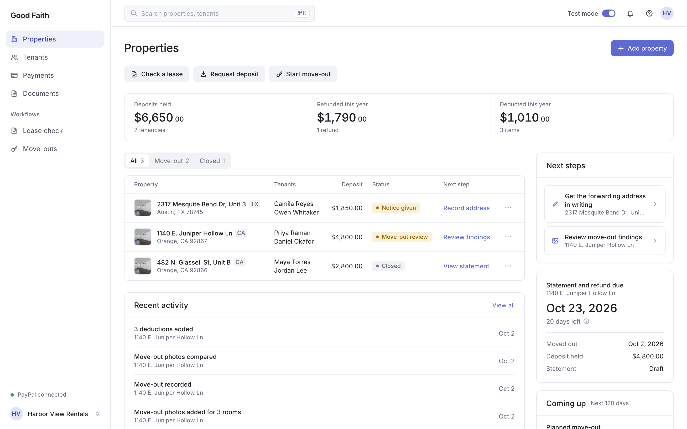
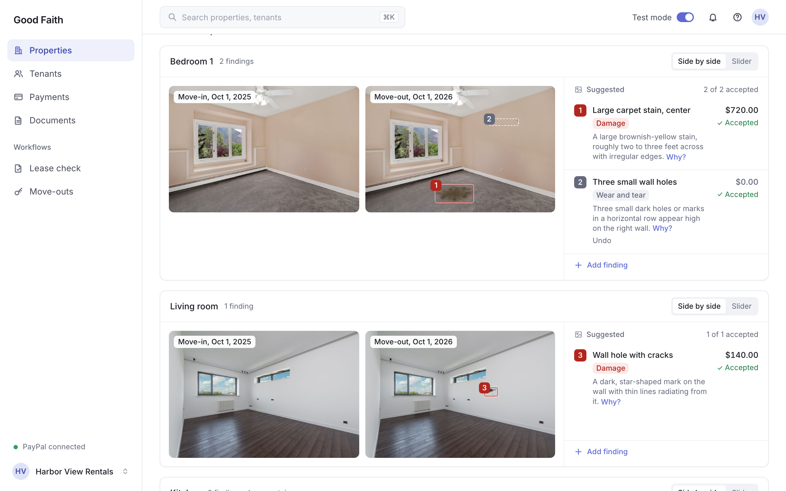
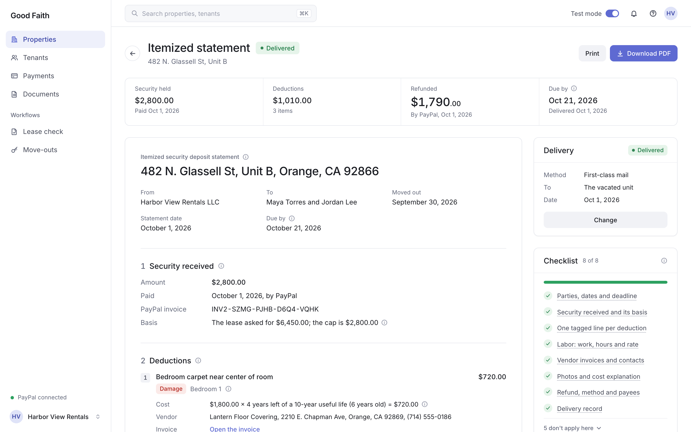

# Good Faith

California penalizes the "bad faith" retention of a security deposit. Good Faith makes the landlord's close-out lawful and fair to the tenant.

An AI agent that runs a California security deposit from move-in to refund for small landlords: the owner of one condo, a duplex or an ADU who manages it alone. It reads the lease and flags what breaks Civil Code 1950.5, collects only the lawful deposit through a PayPal invoice, keeps the move-in and move-out photos the law now requires, has Claude compare them room by room, computes every deduction in code, writes the itemized statement with its exhibits, and returns the deposit through PayPal's Agent Toolkit once the landlord approves. Built for the [PayPal AI Hackathon](https://paypalaihackathon.devpost.com/).

It organizes records and fills in templates from the statute and published state guidance. It does not give legal advice.







Demo video: [to be added before submission]

## Try it

Hosted demo: [good-faith.onrender.com](https://good-faith.onrender.com). It runs in the PayPal sandbox, so no real money moves. It is on Render, and the first page after a quiet spell can take up to a minute while the server wakes.

1. Open the link and enter the access code from the submission's testing instructions. Your browser gets its own private copy of a small landlord, Harbor View Rentals, made the moment you enter the code and dated to that day. Nobody else sees your copy, and you see nobody else's.
2. Properties shows three units, all managed by Harbor View Rentals (1140 E. Juniper Hollow Ln is owned by Elena Marquez, whose name is on its lease and its refund). 482 N. Glassell St, Unit B closed out a few days ago: deposit refunded through PayPal, itemized statement delivered, and the tenants' dispute of it settled since. 1140 E. Juniper Hollow Ln moved out yesterday, with 20 days left to send the statement and the refund. Each deposit is a real sandbox payment made for the demo, so PayPal dates it recently rather than at move-in a year ago.
3. 2317 Mesquite Bend Dr, Unit 3 is in Austin, so the same engine applies Texas law to it (the "Rules: Tex. Prop. Code ch. 92" chip): the tenants gave notice and move out when the lease ends, in 10 days, the next step is their forwarding address in writing, and the refund is due 30 days after they surrender the unit; the chip's tip names the Texas bad-faith penalty ($100, three times what is wrongfully withheld, and attorney's fees). Its deposit is one sandbox payment every copy shares, so its refund stays off, and PayPal dates that payment the day the demo was built, after the notice.
4. Open 1140 E. Juniper Hollow Ln and its Move-out tab: the move-in and move-out photos side by side, Claude's findings boxed on the photos, and the three deductions computed in code.
5. Review refund, then Prepare refund. The close-out agent reads the file, checks the deposit with PayPal and proposes $3,790.00 back to the tenants' original payment. Send refund approves it, and PayPal's Agent Toolkit sends a real sandbox refund against your copy's own pre-paid sandbox deposit. Refund sent shows PayPal's refund id; the statement is next.
6. Dispute it as the tenants. Open the Statement and Record delivery (any method): the tenants can dispute a statement once it is out. Then Open the tenant's view, under the delivery record or under the refund on the Move-out tab: the tenants' private page opens in a new tab. Under Deductions, Dispute it: pick the carpet or the range cleaning, say why in a few words, and Ask my advocate: the tenants' Claude agent writes their case against each charge's lawful range (about a minute). Send it to the landlord.
7. Back on the property's Move-out tab (the bell says the tenants disputed, and Properties shows the unit as Disputed), set a limit if you like and press Let my negotiator answer: the landlord's negotiator and the tenants' advocate take turns, up to three exchanges, each turn checked by code against the law before it is shown. Both pages show every turn as it lands.
8. When they agree, Accept settlement on the tenants' page, then Approve and pay on the property: PayPal refunds the agreed amount against the same deposit payment (a second real sandbox refund of your copy's own deposit), the statement becomes the amended statement, and Payments shows a Settlement row. If they don't agree, either side can make its own offer, and the tenants' page says what the state's process is.
9. To see a finished one without waiting, open 482 N. Glassell St, Unit B and its Move-out tab: the tenants disputed the carpet and the range cleaning, and the two agents settled at $270.00 back in two exchanges. Open each turn's reasoning, then Amended statement; Open the tenant's view shows the same dispute from the tenants' side. It comes with the demo as a recorded example: its turns were written ahead and passed the same checks as a live run, and no PayPal money moved for it, so every page that shows it says "Demo example".
10. Everything else works too: check a lease (`demo/lease-single-owner.pdf`, or `demo/lease-texas.pdf` for Texas), start a tenancy, add photos and deductions. Start over, in the account menu, gives your browser a fresh copy.

The demo has daily limits on the Claude jobs (the advocate runs three times a day per tenant link, the negotiator three times per copy) and on new copies per network. If the day's pre-paid sandbox deposits run out, the Review refund page says so and the rest of the copy still works. Copies are removed after two weeks.

A short script for a video of the whole flow, beat by beat, is in [docs/DEMO_SCRIPT.md](docs/DEMO_SCRIPT.md).

## The problem

California rewrote the security deposit rules four times in three years, and the people most likely to get them wrong are landlords with one unit who keep everything in texts and Venmo screenshots. The rules the app enforces (all citations are to Civil Code 1950.5; the full spec is [docs/LEGAL_RULES.md](docs/LEGAL_RULES.md)):

- **The cap.** Security is everything charged at the start of the tenancy except first month's rent, however it is labeled, and it may not exceed one month's rent. A landlord who is a natural person (or an LLC of natural persons) with no more than two rental properties and four units may take two months. (a), (b), (c)(1), (c)(5), AB 12, for deposits demanded on or after July 1, 2024. No part of it may be called nonrefundable, (n).
- **Photos.** For tenancies that began on or after July 1, 2025, the landlord must photograph the unit at move-in, (g)(1). For any repair or cleaning deducted after April 1, 2025, photos before the work and after it, (g)(2). AB 2801. Without them, the documentation the statement must include, (h)(2)(D), cannot be met.
- **Electronic refunds.** Since January 1, 2026, a landlord who received the deposit or rent electronically must refund the deposit electronically, to an account the tenant designates or "by any electronic or virtual method available to the landlord if agreed to in writing by the tenant", (h)(1)(A), AB 414. PayPal qualifies only with that written agreement, so the app records it at move-in. The statute also calls for a written notice of the right to an electronic refund after notice to terminate, (h)(1)(A)(ii)(II), unless the parties already agreed in writing on the method of return; the app treats the signed PayPal agreement as that agreement and drafts the notice when there is none.
- **21 days.** The itemized statement and the refund are due within 21 calendar days after the tenant vacates, (h)(1), with the invoices, receipts, labor time and rates, and the photos attached, (h)(2)(A)-(D), unless repair and cleaning deductions total $125 or less, (h)(4).
- **The penalty.** Bad-faith retention can cost up to twice the deposit in statutory damages on top of actual damages, and the landlord bears the burden of proving every deduction was reasonable, (h)(7), (m).

## How it works

1. **Check the lease** (`/lease`, "Check a lease" in the sidebar). Upload the lease PDF. Claude extracts the deposit terms as facts with the exact wording it relied on (`src/lib/extract.ts`); the rules engine (`src/lib/rules.ts`) flags violations, warnings and required steps with the statute beside each flag, and computes the lawful deposit.
2. **Start the tenancy** (`/tenancy/[id]`). The property, tenants, rent and terms are saved with every flag. Each property opens on a record header (photo, address, status, the statement and the one primary action) over five tabs: Overview, Move-out, Payments, Documents and Tenants.
3. **Move-in.** The tenants agree in writing that the refund comes back by PayPal (AB 414). The agent sends a PayPal invoice for the lawful amount, capped at the statute, and the page shows "Paid" the moment PayPal does. Move-in photos go in room by room.
4. **The tenants' private link** (`/t/<token>`). A page for the tenants: what they paid, the agreement, the move-in photos, a form to say they are moving out with the forwarding address the statement is mailed to, and the statement once it is delivered. The token is hashed in the database and can be revoked.
5. **Notice.** When the tenants give notice, the app records the planned move-out, drafts the initial-inspection notice, (f)(1), and the electronic-refund notice when one is owed, and offers an `.ics` file with the window, the move-out and the 21-day deadline.
6. **Move-out.** Photos of each room before any repair or cleaning. Claude compares them with move-in, room by room, and classifies each change as wear and tear (never chargeable), damage, cleaning, or unclear (`src/lib/inspect.ts`). It classifies; it does not price.
7. **Deductions.** One form per finding. The landlord enters the facts (a vendor invoice or own hours and rate, the item's age, the receipt, the after-repair photos) and the code computes the amount with useful-life or paint-schedule proration from the DRE guide, marks estimates under (h)(3), and tracks the $125 documentation rule (`src/lib/deductions.ts`).
8. **Close out.** The agent (`src/lib/agent.ts`) reads the close-out facts from the rules engine, confirms the deposit invoice with PayPal, proposes the refund on the rail the rules allow (a refund of the original payment inside PayPal's 180-day window, otherwise a Payout), waits for the landlord's approval, sends it, confirms the refund, and grades the statement against the 13-item checklist.
9. **The itemized statement.** A statement page and a one-click PDF packet with the photo exhibits and vendor invoices (`src/lib/statement.ts`, `src/lib/statement-pdf.ts`), plus a delivery record: personal delivery, first-class mail, or email by written agreement, (h)(1)(B), (h)(6).
10. **Properties** (`/units`, the landlord's home; `/` opens it). Every tenancy, what it holds, its status and the next thing the law asks for, worked out from the dates, with the deposits held, refunded and deducted this year, recent activity, the next steps and the nearest 21-day deadline. Tenants, Documents and Move-outs list the same tenancies by person, by paper and by deadline.
11. **Payments** (`/ledger`). Every deposit invoice, payment, deduction, refund and payout across every unit in one AG Grid, each row tagged with the part of Civil Code 1950.5 that applies to it ((b)(2) damage, (h)(1) 21 days, and so on, with the subsection's words on hover and in the CSV). Search, filter any column, sort, and download a CSV that respects the filters; the totals follow whatever is showing. "Still held" is what was collected, less the deductions on a statement that has gone out and less what went back: drafts take nothing out yet, a refund PayPal refused moved nothing, and each tenancy is clamped at zero on its own, so the figure agrees with the Properties page. Each tenancy page carries its own money timeline with a way into the ledger filtered to that tenancy (not its address, so a re-let unit never shows the previous tenants' money) (`src/lib/ledger.ts`, `src/app/(landlord)/ledger/`).

12. **Disputes** (`/t/<token>/dispute`). Once the statement is out, the tenants can dispute deductions from their link: pick the charges, say why, add photos, and ask their advocate, a Claude agent working for them, to write their case from the statement, the photos and the comparison's boxes, the deduction math and documents, and the state's rules. Code computes each charge's lawful range first (`src/lib/lawful-range.ts`: $0 and "unlawful" for wear and tear, a state bar, or every charge after a late statement that forfeits on every reading of the dates; $0 and "unsupported" for a charge missing the documents California requires, which the landlord can still supply; the guidance-prorated value for an over-long useful life), and the advocate's case is held to it: no amount outside the range, "unlawful" or "unsupported" only where the code says so, citations only from the pack, and wording that goes past informing (suing, courts, who would win) replaced with the code's own. The tenants send the advocate's case only while it matches their reasons; otherwise they send their reasons on their own. While a sent dispute is open, the statement's deductions can't be added or removed. Sending it opens the dispute on the property's Move-out tab, with a banner on every tab.
13. **Negotiation and settlement.** On the Move-out tab the landlord sets a policy for its own negotiator, a Claude agent working for the landlord (`src/lib/negotiator.ts`): concede automatically what the law and the records don't support, and ask before giving back more than a set amount. "Let my negotiator answer" starts the two agents: the negotiator answers the tenants' case charge by charge with the landlord's evidence (concede, hold or counter, each with a reason and a citation from the pack), the tenants' advocate answers back, and so on for at most three exchanges. Code checks every turn before anyone sees it: each figure inside the charge's lawful range, every counter between the two sides' last figures so nobody takes back a concession, the landlord's limit (kept private from the tenants), citations from the pack and wording that informs. The loop stops early when both sides' figures give back the same amount or when an exchange moves neither side, and each turn appears on both pages as it is made, with its reasoning. A settlement takes effect only when the tenants accept it on their link and the landlord approves it ("Approve and pay"); then the agreed amount goes back on top of the statement's refund (`src/lib/settlement.ts`). It uses the same PayPal Agent Toolkit over MCP and the same rail rule as the close-out (`src/lib/refund-rail.ts`: a partial refund of the original payment while it is inside PayPal's window and enough of it is left, else a Payout to the account the tenants named), with its own guard rather than the close-out's `guardRefund`: a claim in the database, so a double click pays once and only after both humans said yes, then a plan recomputed from the database and PayPal's live state right before the call, which refuses a deposit the workspace doesn't own, PayPal unreachable, and a statement whose own refund hasn't gone yet. The close-out's other blockers limit what a landlord may keep, so they don't stop a settlement, which only gives more back. Every attempt carries an idempotency key (PayPal-Request-Id, or the Payout's batch id): if PayPal never answers, the settlement is frozen (no offer, acceptance or new attempt can touch it) until "Check with PayPal" sends the same request again, and PayPal answers with the first payment if it went or makes it once if it didn't. The statement and its PDF become the amended statement (the original deductions, the agreed adjustment, the new totals, who accepted and approved it and when, the PayPal id), the ledger shows a Settlement row, and the tenants' page shows the settled amount. Without agreement, both final positions are recorded, the tenants' page says plainly what the state's process is (the pack's forum, with its citation, never advice), and either side can still make its own offer.

Every action, by whom and with what, is written to an audit log the tenancy page shows.

## Disputes and settlement

Two Claude agents negotiate a disputed statement for two humans, inside limits set by code and law, and PayPal pays only after both humans say yes.

1. **The tenants dispute.** From their private link, once the statement is out, they pick the charges and say why. Their advocate (`src/lib/advocate.ts`) reads the statement, the photos with the comparison's boxes, the math and the documents, and the state's rules, and writes their case charge by charge: solid, weak, not supported or not allowed, with a citation and a proposed figure. They send the case, or their own reasons.
2. **The agents negotiate.** The landlord sets a policy for its negotiator (`src/lib/negotiator.ts`): concede what the law and the records don't support, and ask before giving back more than a limit it keeps private. The negotiator answers with the landlord's evidence (concede, hold or counter per charge), the advocate answers back, at most three exchanges, stopping early when they agree or neither moves. Both humans see every turn and its reasoning as it lands.
3. **Both humans approve.** A settlement takes effect only when the tenants accept it on their link and the landlord approves it with "Approve and pay". Then the agreed amount goes back through PayPal on the close-out's own rail (`src/lib/settlement.ts`, `src/lib/refund-rail.ts`): a partial refund of the original deposit payment through the Agent Toolkit over MCP, or a Payout to the account the tenants named when the payment can't be refunded. The statement and its PDF become the amended statement.
4. **No agreement.** Both final positions are recorded, either side may still make an offer, and the tenants' page says plainly what the state's process is (small claims in California, with the pack's citation). Not legal advice.

**Why code bounds the agents.** The models argue; code decides what is possible. Before either agent speaks, `src/lib/lawful-range.ts` computes each charge's lawful range from the deduction math and the state pack: $0 for wear and tear or a charge the state bars, $0 for a California charge missing the documents the law requires, the guidance-prorated value for a replacement, every charge after a statement that forfeits on every reading of the dates. Every turn is checked before anyone sees it: each figure inside its range, every counter between the two sides' last figures (no taking back a concession), the landlord's private limit, citations only from the state's pack, and wording that informs rather than advises (no suing, courts or predictions). What the code changed is listed on the turn. So no model can propose an amount the law doesn't allow, and words planted in a dispute can steer wording at most, never money.

**Why two approvals and a guard.** The payment is claimed once in the database, so a double click pays once and only after both humans said yes; it is planned again from the database and PayPal's live state right before PayPal is called, refuses a deposit the workspace doesn't own, and carries an idempotency key, so a payment PayPal never confirmed is checked with the same request rather than sent twice.

## Architecture

| Piece | What it does |
|---|---|
| **Next.js 16** (App Router, TypeScript, Tailwind 4) | One app: server components read the database directly; route handlers under `src/app/api` do the writes and the money. |
| **Design system** (`src/app/globals.css`, `src/components/`) | Tailwind 4 theme tokens: a white canvas, neutral grays, one indigo for actions, green, amber and red for status only; Inter (via `next/font`) in six sizes with tabular figures for money. Legal detail and citations live behind info icons and "Why?" popovers. |
| **Claude via the AI SDK** (`ai` v7, `@ai-sdk/anthropic`, Claude Opus 5.5) | Five jobs. Lease extraction and the photo inspection use `generateText` with `Output.object` and a Zod schema, so Claude returns facts in a fixed shape. The close-out agent uses `generateText` with tools, a step limit, and `needsApproval` on every money tool. The tenants' advocate (`src/lib/advocate.ts`) uses `generateText` with read-only tools (the statement, the findings, the photos with their boxes drawn, the deductions and the state's rules) and `Output.object`, and code holds its case to the lawful range (`src/lib/lawful-range.ts`). The landlord's negotiator and the advocate's answers in the negotiation (`src/lib/negotiator.ts`) are one `generateText` call per turn with `Output.object`, the file in the prompt and no tools, and code checks each turn against the range, the other side's figures and the landlord's limit. |
| **PayPal Invoicing and Payouts** (`src/lib/paypal.ts`) | REST calls in the sandbox: create and send the deposit invoice, read its live status, and send a Payout when a refund against the original payment is not possible. |
| **PayPal Agent Toolkit over MCP** (`src/lib/agent.ts`) | `@paypal/agent-toolkit/mcp` runs as an MCP server inside the process (an in-memory transport), limited to `get_invoice`, `create_refund` and `get_refund`, and the agent consumes it through `@ai-sdk/mcp`. `create_refund` is wrapped so it waits for approval and passes the rules guard before PayPal is called. |
| **Supabase** (`src/lib/db.ts`, `supabase/migrations`) | Postgres and Storage. The server-only client uses the secret key; row level security is on with no policies, so the publishable key can read and write nothing. Every query is scoped in code to the session's workspace: the owner's, or a visitor's private copy of the demo, made in one Postgres function (`src/lib/workspace.ts`). Three private buckets (`leases`, `photos`, `receipts`) served through one-hour signed URLs. Row-locking functions make the concurrent writes atomic. |
| **AG Grid Community** (`ag-grid-community`, `ag-grid-react`; `src/app/(landlord)/ledger/ledger-grid.tsx`) | The deposit ledger: every money event and deduction across every unit, with the quick filter, text, number and date column filters, auto-height rows that wrap the unit, detail and status text, the amount column pinned on the right so a phone still shows every figure, a pinned total row and the CSV export, all from the free build (no Enterprise features, no license key). The Quartz theme takes the app's color tokens through the Theming API, and the rows arrive from the server as plain data. |
| **pdf-lib and sharp** | The statement packet: standard fonts, photos re-encoded at 1600 px, invoices embedded as pages. |
| **Browser uploads** (`src/lib/uploads.ts`) | Photos are downscaled on a canvas before they leave the phone, with the EXIF orientation applied, and sent in requests under the host's 4.5 MB body limit. |

Where things live:

```
src/app/(landlord)/layout.tsx     the app shell: sidebar, top bar, Test mode, notifications
src/app/(landlord)/units/         Properties, the landlord's home
src/app/(landlord)/lease/         Check a lease
src/app/(landlord)/ledger/        Payments, the AG Grid deposit ledger
src/app/(landlord)/tenancy/[id]/  one property: header, five tabs and their client components
src/app/(landlord)/tenants/, documents/, move-outs/   the other sidebar lists
src/components/                   the design system: buttons, chips, money, cards, tabs, tables, tooltips, the shell
src/lib/property-view.ts          each tenancy's status chip and the one verb its next step links to
src/app/t/[token]/                the tenants' private page
src/app/api/                      route handlers (lease, tenancies, photos, deductions, close-out, statement, notices, tenant link, access, health)
src/proxy.ts                      the demo access gate: every landlord page and route needs the session /access sets
src/lib/session.ts, limits.ts     the signed session cookie; the daily limits on Claude jobs, invoices, tenancies and uploads
src/lib/workspace.ts, demo-pool.ts   workspaces: scoping every read and write, the private demo copies, the pre-paid deposits
src/lib/rules.ts                  the lease rules, by rule id from docs/LEGAL_RULES.md
src/lib/deductions.ts             deduction math, proration, the $125 rule
src/lib/closeout.ts               close-out facts, the refund plan, guardRefund
src/lib/ledger.ts                 ledger rows with their 1950.5 tags, and the totals
src/lib/agent.ts                  the close-out agent and the PayPal toolkit over MCP
src/lib/statement.ts, statement-pdf.ts   the itemized statement and its PDF packet
docs/LEGAL_RULES.md               the 30-rule legal spec the code enforces
docs/DEPLOY.md                    hosting on Render and Supabase
supabase/migrations/              the database schema, in order
scripts/                          setup scripts, the demo seed and reset, the deposit pool and the sweep, the sandbox payer
render.yaml                       the Render service (no values; they are entered in the dashboard)
demo/                             the fictional lease, photos and receipts
```

## Safety design

Money and law are handled in four layers, so the model never decides an amount and never moves money on its own.

1. **Code decides the amounts.** The cap comes from `rules.ts`, each deduction from `deductions.ts`, and the refund plan (rail, amount, the PayPal capture id or the designated email) from `closeout.ts`. The agent is told that these facts are authoritative.
2. **The agent operates.** Claude reads the facts, confirms the invoice with PayPal, proposes the refund with the plan's exact amount, confirms the refund and grades the statement. It cites only the citations the facts carry, never from memory.
3. **The landlord approves.** `create_refund` and `send_payout` carry `needsApproval`; the run pauses, the proposal is shown next to what the rules say, and nothing moves until the landlord clicks approve. A run is claimed atomically so a double click cannot resume it twice, and after a decline the run resumes with no money moved and the agent says so. The hosted demo puts every landlord page and route behind a shared access code with daily limits on the Claude jobs, and each visitor works in a private copy of the demo, but that code is not a per-landlord login, so the close-out routes still refuse a `LIVE` PayPal environment and move sandbox money only (see [docs/DEPLOY.md](docs/DEPLOY.md), sections 8 and 9).
4. **guardRefund re-checks.** At the moment a money tool executes, `guardRefund` recomputes the facts from the database and PayPal and blocks any rail, amount, capture id or email that does not match, writing the reason to the audit log. A deduction edited after the proposal, a second click, or a model mistake all stop there.

Beyond money: the app never holds funds (the landlord's PayPal business account does); every action is audited with its actor; the tenants' page shows them their own records only, through a revocable hashed token; and the copy presents rules and facts, never advice (section F of the legal spec).

## States

Good Faith runs California, New York, Texas, Florida and Washington. The property's state picks its rule pack (`src/lib/states/`), and every number, deadline, notice, document rule, refund-method rule, penalty and citation comes from that pack; the engine, the PayPal rails and `guardRefund` are the same for all five. The lease check reads the state from the lease (the landlord can correct it), and any other state is refused with a plain message naming the five.

What differs, in short:

- **California** (Civ. Code 1950.5): a one-month cap (two for a small landlord), move-in and move-out photos, the refund back electronically, receipts over $125, and the statement and refund within 21 days of move-out.
- **New York** (GOL 7-103, 7-108): a one-month cap, the deposit held in trust (interest in buildings of six or more units), a move-in inspection offer, an inspection before move-out on request, and the statement within 14 days (a 14th day on a weekend or public holiday runs to the next business day), or every deduction is forfeited unless the landlord records why one stays.
- **Texas** (Prop. Code 92.101 to 92.113): no cap; the refund and itemized list within 30 days of surrender, owed once the tenants give a forwarding address in writing.
- **Florida** (Stat. 83.49): no cap; the deposit back within 15 days, or a claim notice by certified mail within 30 days, the tenants' 15 days to object, and the balance within 30 days of the notice; after a timely objection the claim stays disputed, not deducted.
- **Washington** (RCW 59.18.260 to 59.18.285): no deposit without a signed move-in checklist, the deposit in a trust account, and a full statement with the invoices within 30 days.

City rules (New York City, Seattle, Austin and others) are shown as warnings only, never enforced. Each property shows its rules as a chip ("Rules: Civ. Code 1950.5") with what that statute governs. Not legal advice: the packs encode the statutes, and the app enforces, warns and drafts for the landlord to approve. [docs/rules/README.md](docs/rules/README.md) has how the packs work, what each holds, the inventory of California's rules, and the per-state specs.

## Legal sources and the disclaimer

The rules come from the current text of Civil Code 1950.5 on [leginfo.legislature.ca.gov](https://leginfo.legislature.ca.gov/faces/codes_displaySection.xhtml?lawCode=CIV&sectionNum=1950.5), as amended by AB 12 (2023), AB 2801 (2024), SB 611 (2024) and AB 414 (2025), the DRE's California Tenants guide (2026 edition), the Courts' self-help guide and the Attorney General's fact sheet. [docs/LEGAL_RULES.md](docs/LEGAL_RULES.md) lists every source, each rule with its subsection, the statement checklist, the wear-and-tear guide, the edge cases, and the guardrails. Useful-life proration and the paint schedule are DRE guidance, not statute, and the app says so wherever it uses them.

The disclaimer the app shows: "This tool organizes your records and fills in templates based on California Civil Code 1950.5 and published state guidance. It does not give legal advice, does not evaluate your specific situation, and is not a substitute for a California attorney."

## Setup

### Environment variables

All of them live in `.env.local`, which is gitignored. The setup scripts below write it; nothing else should. No values here, ever. `.env.example` lists every name with a placeholder.

| Variable | Used for | Set by |
|---|---|---|
| `SUPABASE_URL` | The Supabase project URL | `scripts/setup-supabase.sh` |
| `SUPABASE_SECRET_KEY` | The project's secret key (`sb_secret_...`); server only, bypasses RLS | `scripts/setup-supabase.sh` |
| `PAYPAL_ENVIRONMENT` | `SANDBOX` (the default) or `LIVE`. The close-out routes refuse `LIVE` until a landlord sign-in exists | `scripts/setup-sandbox.sh` |
| `PAYPAL_CLIENT_ID`, `PAYPAL_CLIENT_SECRET` | The PayPal app's credentials | `scripts/setup-sandbox.sh` |
| `ANTHROPIC_API_KEY` | The app's own Claude calls | `scripts/setup-anthropic.sh` |
| `ANTHROPIC_MODEL` | Optional. Overrides `claude-opus-5-5` for all three Claude jobs | by hand |
| `GOOD_FAITH_ACCOUNT` | Optional. The owner workspace's account name in the app's sidebar and PayPal card; without it, the owner of the oldest tenancy. Demo copies always show Harbor View Rentals | by hand |
| `PAYPAL_SANDBOX_BUYER_EMAIL`, `PAYPAL_SANDBOX_BUYER_PASSWORD` | Optional. The sandbox personal account that pays the demo invoice | `scripts/setup-sandbox-tenant.sh` |
| `PLAYWRIGHT_PYTHON` | Optional. The Python with Playwright the demo seed uses | by hand |
| `DEMO_BASE_URL` | Optional. Where the demo seed sends its requests (default `http://localhost:3210`) | by hand |
| `DEMO_ACCESS_CODE` | Optional. The code the demo seed enters when the site it seeds is behind the access gate (use the owner code) | by hand |
| `GOOD_FAITH_ACCESS_CODE`, `GOOD_FAITH_OWNER_CODE`, `GOOD_FAITH_SESSION_SECRET` | The hosted demo's access gate: the judges' code (each browser that enters it gets a private copy of the demo), the owner's code (your own data), and the secret (32+ characters) that signs the session cookie. Leave them unset for local dev, where the gate is off; a production host without them shows "This demo is not configured". See [docs/DEPLOY.md](docs/DEPLOY.md), section 8 | on the host |
| `GOOD_FAITH_DAILY_*`, `GOOD_FAITH_INSPECT_ROOMS`, `GOOD_FAITH_INSPECT_PHOTOS` | Optional. The daily limits on Claude jobs, sandbox invoices, new tenancies, stored uploads and new demo copies, and the inspection's size; defaults in [docs/DEPLOY.md](docs/DEPLOY.md), section 8 | on the host |
| `GOOD_FAITH_CLIENT_IP_HEADER` | Optional, and not on Render. The header with the caller's real address, for the wrong-code limit; see [docs/DEPLOY.md](docs/DEPLOY.md), section 8 | on the host |

### Run it locally

```bash
npm install
scripts/setup-supabase.sh        # SUPABASE_URL and SUPABASE_SECRET_KEY
scripts/setup-sandbox.sh         # PAYPAL_CLIENT_ID and PAYPAL_CLIENT_SECRET (sandbox)
scripts/setup-sandbox-tenant.sh  # the sandbox personal account that plays the tenant (demo seed only)
scripts/setup-anthropic.sh       # ANTHROPIC_API_KEY
npm run dev -- -p 3210
```

Each script asks for its values with the secrets hidden, writes them to `.env.local` with mode 600, and checks them against the service before it says saved.

The database schema is in `supabase/migrations`, one file per change, in order. Run them in the Supabase SQL editor from the first to the last. The first one also creates the private buckets. Hosting, including what to set in Supabase, PayPal and Render, is in [docs/DEPLOY.md](docs/DEPLOY.md).

### Checks

```bash
npx tsc --noEmit
npx eslint src --max-warnings=0
npx next build        # in a copy of the repo, not next to a running dev server
node scripts/ca-snapshot.mjs        # California's output is exactly the recorded baseline
node scripts/state-packs-check.mjs  # the per-state rule checks
node scripts/lawful-range-check.mjs # disputes: the lawful range in five states and the advocate against a stubbed model
node scripts/negotiation-check.mjs  # the negotiation: turn checks, offers and the loop's stops, both agents stubbed
```

`next build` needs `.env.local` (or the same variables in the environment): the server modules create their clients when they load, and the build collects every route. Build in a copy of the repo so it does not clobber the dev server's `.next`: a `git worktree` with `node_modules` cloned in (`cp -Rc node_modules <copy>/`; a symlinked `node_modules` is refused by Turbopack) and `.env.local` copied over.

## Demo

One command builds a complete demo tenancy by driving the app's own APIs, so every step is the real one: the lease check, the tenancy, the tenants' written agreement to a PayPal refund (AB 414), the deposit invoice paid in the PayPal sandbox, move-in photos, the tenants' notice with the written notice it calls for, the move-out date, move-out photos, Claude's room-by-room inspection, three deductions with their receipts and after-repair photos, and the private tenant link. It stops before the close-out, so the agent and the approval happen live.

```bash
npm run demo:seed
```

It prints the tenancy's URL and the tenant's page. Open the tenancy and run the close-out: the agent reads the facts, cites the rules, and proposes the PayPal refund for approval. The tenant's page shows what the tenants see: the deposit paid, the agreement, the move-in photos and, once it is delivered, the statement.

What it needs:

- the dev server on `http://localhost:3210` (or set `DEMO_BASE_URL`; a hosted copy behind the access gate also needs `DEMO_ACCESS_CODE`, the owner code);
- `.env.local` from the setup scripts above, including the sandbox tenant's login. The seed refuses to run when `PAYPAL_ENVIRONMENT` is `LIVE`;
- a Python with Playwright and Chromium (`pip install playwright && playwright install chromium`), which pays the invoice as the sandbox tenant and dates the receipt exhibits. If that Python is in a virtualenv, set `PLAYWRIGHT_PYTHON` to it in `.env.local` or the shell. The seed checks for the browser before it spends a Claude call.

The seed takes about three minutes. The sandbox checkout is driven by a headless browser; if PayPal's login page times out, the seed prints the invoice link: pay it in a browser as the sandbox tenant and run the same command again, and it continues from there.

What it costs: two Claude steps (reading the lease, then the inspection with one call per room) and one PayPal sandbox payment from the test tenant's fake balance. Everything else is deterministic code.

Dates: the records read like a tenancy that ran for a year. The move-in steps are dated the lease start, the notice the day it was given, and the move-out steps the move-out date. One date is PayPal's: it dates the sandbox payment the day the seed runs, so the statement says the deposit was paid that day. The move-out date defaults to that same day, so the 21-day clock starts then. With `--move-out` set to an earlier day, the statement shows the deposit paid after the tenants left; say so on camera, or seed on the day of the move-out.

Options:

| Command | What it does |
|---|---|
| `npm run demo:seed` | Builds the demo tenancy, or continues an unfinished one at the demo address (each finished step is skipped) |
| `npm run demo:seed -- --fresh` | Starts another demo tenancy even if an unfinished one exists |
| `npm run demo:seed -- --tenancy <id>` | Continues that tenancy |
| `npm run demo:seed -- --until inspect` | Stops before a step, to show it live. Steps: `lease`, `agreement`, `invoice`, `pay`, `move_in_photos`, `notice`, `move_out_date`, `move_out_photos`, `inspect`, `deductions`, `tenant_link` |
| `npm run demo:seed -- --move-out 2026-09-28` | Sets the move-out date (not in the future). Default: the day the seed runs |
| `npm run demo:seed -- --state TX` | Builds the Texas demo tenancy from `demo/lease-texas.pdf` (2317 Mesquite Bend Dr, Unit 3, Austin): the lease check, the tenants' PayPal account, the deposit paid in the sandbox, move-in photos, and the tenants' notice to leave at the lease end with the tenant link. It stops there, before the forwarding address; a demo copy dates the notice 20 days back, so its tenants move out in 10. One Claude call and one sandbox payment |
| `npm run demo:reset -- <tenancyId>` | Removes one tenancy: its rows and its photos, receipts and lease PDF in storage. It refuses the templates the hosted demo's copies are made from. PayPal sandbox records stay |
| `npm run demo:pool -- --status` / `--fill 4` | The hosted demo's pre-paid sandbox deposits: what is ready, or top it up to 4 (one invoice paid as the sandbox tenant each) |
| `npm run demo:sweep` / `-- --apply` | Lists, then removes, the hosted demo's private copies older than 14 days, with their uploads |
| `npm run demo:history` / `-- --apply` | Builds the settled dispute every copy's closed unit shows (the agents' recorded turns, put through the app's own checks), then stores it for the copies. No Claude call, no PayPal call |

### The hosted demo's private copies

The hosted demo doesn't show one shared tenancy. Each browser that enters the judges' code gets a copy of three template tenancies made by the seed (in California one closed out and one stopped before the close-out; in Texas one stopped at the tenants' notice), copied in one Postgres function with every date moved to the day of the copy. The California move-out unit's copy comes with a sandbox deposit paid ahead of time (`npm run demo:pool`), so its refund, and later its settlement, are real sandbox refunds of its own payment. The closed unit's copy comes with a settled dispute as history (`npm run demo:history`): the dispute, every turn, the settlement and the amended statement, marked as the demo's example, with no PayPal money behind it, since its deposit is a payment every copy shares. The Texas unit takes no deposit either: its copies show the template's deposit and never refund it. In a copy, one person plays both sides, so its tenant links can be opened again from the landlord's pages ("Open the tenant's view"). [docs/DEPLOY.md](docs/DEPLOY.md), section 9, covers the templates, the history, the pool, Start over and the sweep.

### The demo lease

`demo/lease-single-owner.pdf` (rendered from `demo/lease-single-owner.html` with `scripts/render_pdf.py`) is a fictional lease by one person who owns one rental, which is what makes the two-month cap apply:

- Rent $2,400, so the small-landlord cap is $4,800 (Civ. Code 1950.5(c)(5)).
- The lease asks a $4,800 deposit plus a $300 "nonrefundable" cleaning fee that "covers professional cleaning at the end of the tenancy". Everything charged at move-in counts as security, so the $5,100 total is $300 over the cap; no part of a deposit may be called nonrefundable (1950.5(n)); and professional cleaning can't be charged regardless of condition (1950.5(e)(2)(C)). The agent flags all three and invoices $4,800.
- A $120 late fee the lease lets the landlord take from the deposit, which gets a warning.
- The deposit is paid through PayPal, so the refund has to go back electronically, and by PayPal only with the tenants' written agreement (1950.5(h)(1)(A)). The tenants sign that agreement at move-in, so the written notice of the right to an electronic refund is not owed later, and the page says so.

`demo/lease-texas.pdf` (from `demo/lease-texas.html`) is the Texas unit's lease, by Harbor View Rentals LLC: rent and deposit $1,850, a $300 "nonrefundable" pet fee that secures against pet damage (flagged: it may be a deposit, Tex. Prop. Code 92.102, and stays off the invoice) and a $90 late fee (checked against the 92.019 safe harbor).

The photos in `demo/photos` show a stained carpet and a few nail holes in the bedroom, a hole in the living room wall, and a grimy range and counter in the kitchen (credits in `demo/photos/CREDITS.md`). The inspection sorts what it sees into damage, cleaning and wear and tear; the nail holes come back as wear and tear and are never charged. The seed then deducts the carpet replacement prorated over its useful life ($1,800 invoice, 6 of 10 years used: $720), the drywall repair ($140) and three hours of the landlord's own cleaning of the range ($150), leaving $3,790 to return. Claude's reading varies a little from run to run: on the carpet it may say to try cleaning first, and the deduction then carries a note that spot cleaning did not lift the stain, which goes on the statement with the cost. A planned deduction whose finding the inspection did not make, or marked unclear, is skipped and named in the output, to add by hand. The receipts in `demo/receipts` are made up.

## License

MIT, see [LICENSE](LICENSE).
