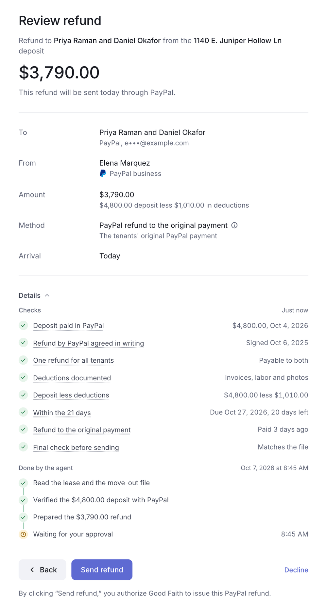
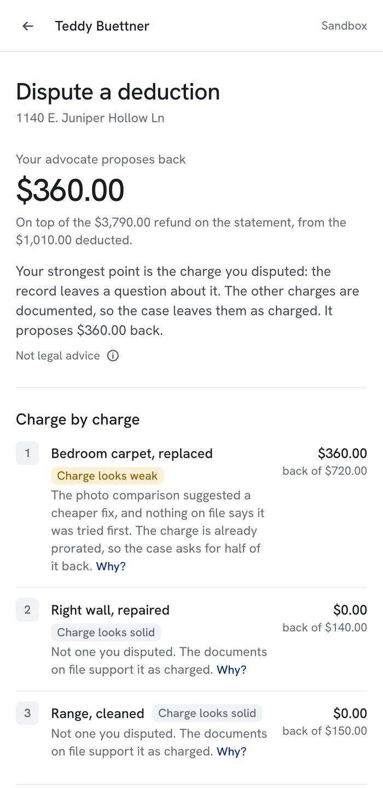
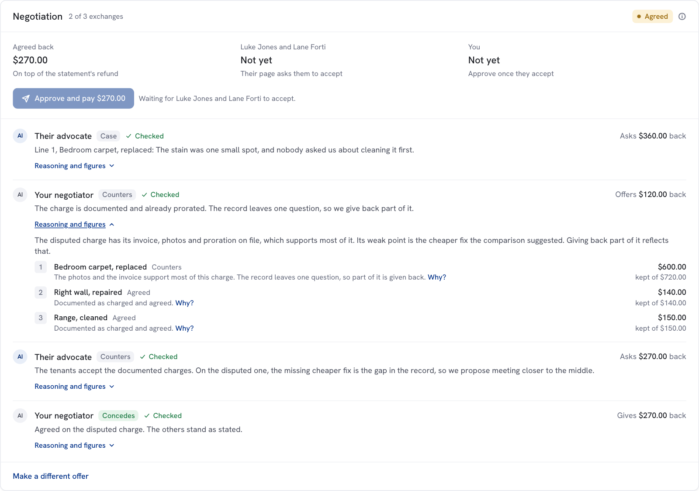
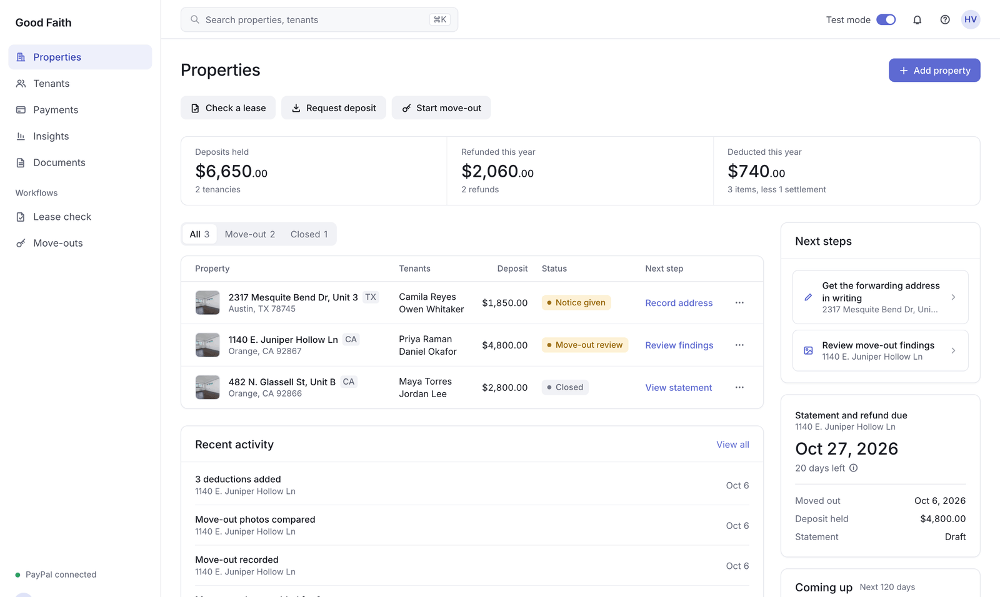
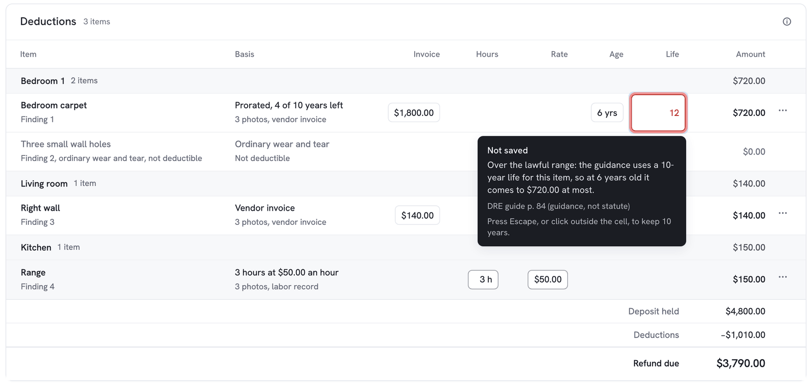
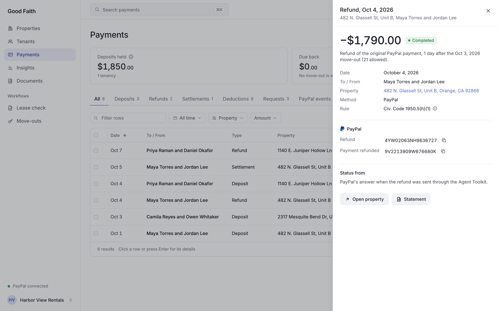
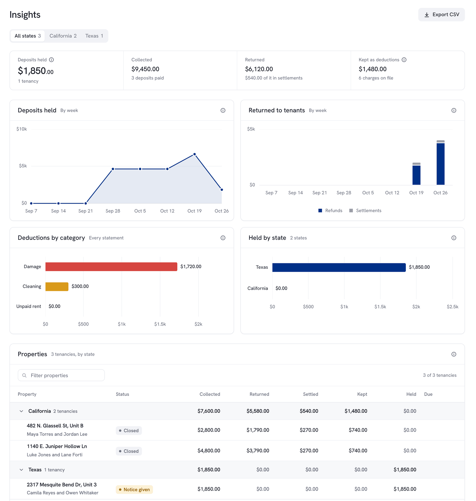
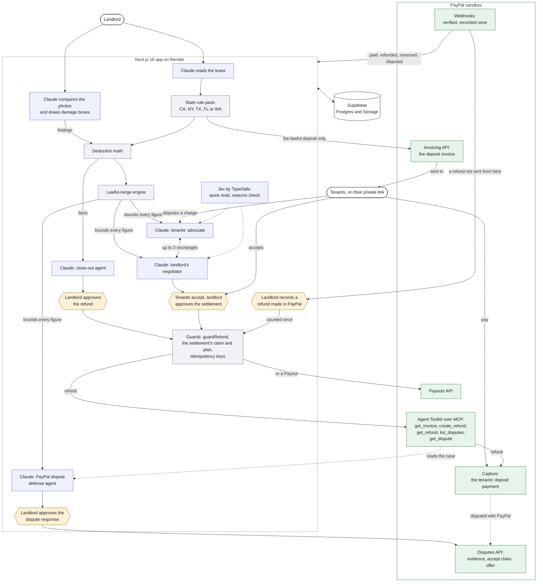
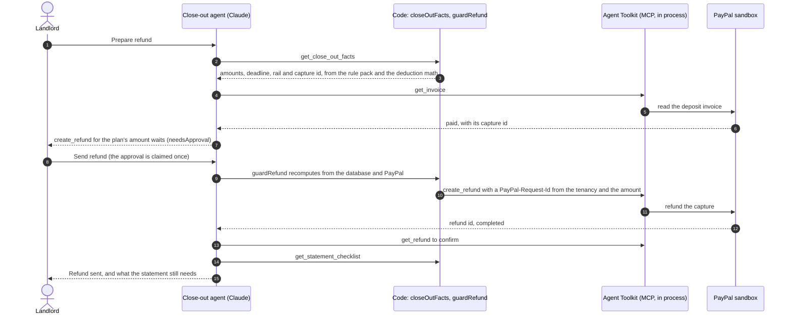

# Good Faith

**Security deposits closed out the lawful way: Claude reads the lease and the photos, code computes every dollar from the state's statute, and PayPal returns the money only after a person approves.**

For small landlords (one condo, a duplex, an ADU) and their tenants in California, New York, Texas, Florida and Washington. Built for the [PayPal AI Hackathon](https://paypalaihackathon.devpost.com/). PayPal sandbox only; no real money moves. It informs, computes and drafts; it does not give legal advice.

[Hosted demo](https://good-faith.onrender.com) · Demo video: to be added before submission · [Demo script](docs/DEMO_SCRIPT.md) · [How it works, in detail](docs/HOW_IT_WORKS.md) · [MIT license](LICENSE)

## What it does, in under a minute

1. **Lease in, lawful deposit out.** Claude reads the lease PDF and quotes the deposit terms it relied on. The state's rule pack flags what breaks the law (a deposit over the cap, a "nonrefundable" fee) and computes the lawful deposit, and a PayPal invoice asks for that amount and no more.
2. **Photos, compared.** At move-out, Claude compares each room's move-in and move-out photos and draws a box around every change: damage, cleaning or wear and tear, which is never charged. It classifies; it never prices.
3. **Every dollar in code.** The landlord enters the vendor's invoice or their own hours, and code computes each deduction (prorated over the item's useful life, with the state's documentation rules) and the refund.
4. **An agent that pays, after a yes.** The close-out agent reads those figures, checks the deposit with PayPal and proposes the refund through PayPal's own Agent Toolkit over MCP. Nothing moves until the landlord presses Send refund, and a guard recomputes the amount and the payment right before PayPal is called. The itemized statement and its PDF packet follow.
5. **Two agents, two humans, one lawful range.** If the tenants dispute the statement, their advocate (a Claude agent working for them) and the landlord's negotiator (one working for the landlord) trade offers for up to three exchanges. Code computes each charge's lawful range first and checks every turn against it. PayPal pays the settlement only after the tenants accept and the landlord approves.
6. **PayPal's side, handled.** Verified webhooks keep each payment's status current, a PayPal dispute gets a response drafted by a defense agent and sent only on the landlord's approval, and a refund made in the PayPal dashboard is matched to its deposit and counted once.


<p>


</p>



<sub>Screenshots from a production build of this repository on 2026-10-07, on a fresh demo copy. The photos, boxes and findings are Claude's, from the demo's seeded inspection. The agents' words and the PayPal answers in these runs came from the end-to-end test's scripted models and in-process fake PayPal, so the pictures cost no Claude call and no PayPal request; the screens are the ones a live run fills.</sub>

## Try it

[good-faith.onrender.com](https://good-faith.onrender.com) runs in the PayPal sandbox. It is on Render, and the first page after a quiet spell can take up to a minute while the server wakes.



1. Enter the access code from the submission's testing instructions. Your browser gets its own private copy of a small landlord, Harbor View Rentals, made the moment you enter the code and dated to that day. Nobody else sees your copy, and you see nobody else's.
2. Properties shows three units. 482 N. Glassell St, Unit B closed out a few days ago: deposit refunded through PayPal, statement delivered, the tenants' dispute settled. 1140 E. Juniper Hollow Ln (owned by Elena Marquez, whose name is on its lease and its refund) moved out yesterday, with 20 days left to send the statement and the refund. Each deposit is a real sandbox payment made for the demo, so PayPal dates it recently rather than at move-in a year ago.
3. 2317 Mesquite Bend Dr, Unit 3 is in Austin, so the same engine applies Texas law to it (the "Rules: Tex. Prop. Code ch. 92" chip): the tenants gave notice, the next step is their forwarding address in writing, and the chip's tip names the Texas bad-faith penalty. Its deposit is one sandbox payment every copy shares, so its refund stays off.
4. Open 1140 E. Juniper Hollow Ln, then its Move-out tab: the photo pairs, Claude's boxes and the three deductions computed in code. Add finding, under a room, reads what you type as damage, cleaning or wear and tear while you type, when the host has a TypeSafe key; Cancel leaves the copy as it was.
5. Review refund, then Prepare refund. The close-out agent reads the file, checks the deposit with PayPal and proposes $3,790.00 back to the tenants' original payment. Send refund approves it, and PayPal's Agent Toolkit sends a real sandbox refund against your copy's own pre-paid sandbox deposit. The receipt shows PayPal's refund id.
6. Dispute it as the tenants. Open the Statement and Record delivery (any method), then Open the tenant's view: the tenants' private page opens in a new tab. Under Deductions, Dispute it: pick the carpet or the range cleaning, say why in a few words, pick your name, and Ask my advocate (about a minute). Send it to the landlord.
7. Back on the property's Move-out tab, press Let my negotiator answer: the two agents take turns, up to three exchanges, each turn checked by code against the law before it is shown on both pages.
8. When they agree, Accept settlement on the tenants' page, then Approve and pay on the property: PayPal refunds the agreed amount against the same deposit payment, the statement becomes the amended statement, and Payments shows a Settlement row.
9. To see a finished one without waiting, open 482 N. Glassell St, Unit B and its Move-out tab: a dispute settled at $270.00 back in two exchanges. It is a recorded example (its turns passed the same checks as a live run, and no PayPal money moved for it), so every page that shows it says "Demo example".
10. Everything else works too: check a lease (`demo/lease-single-owner.pdf`, or `demo/lease-texas.pdf` for Texas), start a tenancy, add photos and deductions. Start over, in the account menu, gives your browser a fresh copy.

The demo has daily limits on the Claude jobs (the advocate three times a day per unit, the negotiator three times a day per browser) and on new copies per network. If the day's pre-paid sandbox deposits run out, the Review refund page says so and the rest of the copy still works. Copies are removed after two weeks.

## Why it matters

California rewrote its deposit law four times in three years (AB 12, AB 2801, SB 611, AB 414): a new cap, mandatory move-in and move-out photos, and refunds that must go back electronically when the deposit or rent came in that way. The statement and refund are due 21 days after move-out, and bad-faith retention can cost up to twice the deposit (Civ. Code 1950.5(h)(7), (m)). The landlords most likely to get this wrong own one unit and keep everything in texts and payment-app screenshots. Good Faith gives them the lawful process step by step, and gives the tenants every charge with its photos, its math and its statute, a private page to dispute it, and an agent of their own. The rules come from the statutes and published state guidance, with sources: [docs/LEGAL_RULES.md](docs/LEGAL_RULES.md) for California, [docs/rules/](docs/rules/README.md) for the other four.

## How PayPal and AI work together

AI proposes, code decides, a person approves, and PayPal moves the money. Each step of a tenancy:

| Step | AI proposes | Code decides | A person approves | PayPal |
|---|---|---|---|---|
| Lease | Claude reads the deposit terms, with quotes ([`extract.ts`](src/lib/extract.ts)) | The rule pack flags violations and computes the lawful deposit ([`rules.ts`](src/lib/rules.ts), [`states/`](src/lib/states/)) | The landlord confirms the state and starts the tenancy | Invoicing API: an invoice for the lawful amount only ([`paypal.ts`](src/lib/paypal.ts)) |
| Move-out | Claude boxes each change on the photos ([`inspect.ts`](src/lib/inspect.ts)); Jev reads a finding as the landlord types it ([`jev.ts`](src/lib/jev.ts)) | Every deduction, prorated, with the documentation rule ([`deductions.ts`](src/lib/deductions.ts)) | The landlord accepts each finding and enters the costs | None |
| Refund | The close-out agent proposes the refund with PayPal's tools ([`agent.ts`](src/lib/agent.ts)) | The plan and the rail ([`closeout.ts`](src/lib/closeout.ts), [`refund-rail.ts`](src/lib/refund-rail.ts)); `guardRefund` recomputes it at the moment of the call | Send refund (`needsApproval` on every money tool) | Agent Toolkit over MCP: `get_invoice`, `create_refund`, `get_refund`; Payouts when the payment can't be refunded |
| Statement dispute | The tenants' advocate and the landlord's negotiator negotiate ([`advocate.ts`](src/lib/advocate.ts), [`negotiator.ts`](src/lib/negotiator.ts)); Jev checks their reasons against the record | Each charge's lawful range, and every turn checked against it ([`lawful-range.ts`](src/lib/lawful-range.ts)) | The tenants accept, then the landlord approves and pays | A partial refund of the deposit payment through the Agent Toolkit, or a Payout ([`settlement.ts`](src/lib/settlement.ts)) |
| PayPal dispute | The defense agent reads the dispute through the Agent Toolkit and proposes one response ([`chargeback-agent.ts`](src/lib/chargeback-agent.ts)) | What is still owed back, so which responses are allowed ([`chargeback.ts`](src/lib/chargeback.ts)) | The landlord approves that exact response | Disputes API: evidence with the statement and photos, accept claim, or offer ([`chargeback-store.ts`](src/lib/chargeback-store.ts)) |
| PayPal's own events | None | Verify, record once, match to one tenancy ([`paypal-webhook.ts`](src/lib/paypal-webhook.ts), [`reconcile.ts`](src/lib/reconcile.ts)) | The landlord records a refund made in PayPal as this deposit's, or sets it aside | Webhooks: invoice paid, capture completed, refunded or reversed, Payouts, disputes |

### Against the judging criteria

| Criterion | Where to look |
|---|---|
| Technical implementation of PayPal + AI | Claude agents use PayPal's Agent Toolkit as an MCP server inside the app's own process, limited to `get_invoice`, `create_refund` and `get_refund`, plus `list_disputes` and `get_dispute` for a PayPal dispute ([`agent.ts`](src/lib/agent.ts)). Invoicing, captures, refunds, Payouts, webhooks checked with PayPal's verify-webhook-signature, and the Disputes API with multipart evidence ([`paypal.ts`](src/lib/paypal.ts)). Every refund and Payout carries an idempotency key from the app's own records, so a retry after a lost answer gets the first result back. Claude through the AI SDK with Zod schemas, tool calls and `needsApproval`; Jev by TypeSafe for split-second typed judgments. |
| Design | A Mercury-style design system: white, neutral grays, one indigo, legal detail behind info tips and "Why?" ([docs/DESIGN.md](docs/DESIGN.md)). WCAG 2.2 AA at 1280 and 390 px, held by a script ([docs/ACCESSIBILITY.md](docs/ACCESSIBILITY.md)). The tenants' page is built for a phone. Every click answers in the next frame ([docs/PERFORMANCE.md](docs/PERFORMANCE.md)). |
| Impact | Five states' deposit law in one engine, for the landlords least able to pay a lawyer and the tenants whose money it is ([Why it matters](#why-it-matters)). |
| Innovation | Two agents negotiating for two humans inside a range code computed from the statute, each turn checked before anyone sees it; a second model (Jev) checking the agents' reasons against the record; PayPal paying only when both humans say yes. |
| Presentation | A hosted demo where each judge gets a private copy, a [demo script](docs/DEMO_SCRIPT.md) beat by beat, and an end-to-end test that walks that script on a production build ([Checks](#checks-and-the-end-to-end-test)). |

### Best Use of PayPal + AI

Claude never touches PayPal on its own judgment of an amount. It reads the facts code computed, then calls PayPal's own tools: `get_invoice` to verify the deposit, `create_refund` for exactly the plan's amount, `get_refund` to confirm it, and in a PayPal dispute `get_dispute` to read the live case (code finds the case with `list_disputes`). Code wraps `create_refund` so it waits for the landlord and passes `guardRefund`, which reads the database and PayPal again and refuses any other rail, amount, payment or account. The same rail rule ([`refund-rail.ts`](src/lib/refund-rail.ts)) sends the close-out and a settlement against the original payment while PayPal's 180-day window allows, and as a Payout to the account the tenants named in writing otherwise. PayPal's webhooks and every live read of the invoice feed back in, so a refund made in the PayPal dashboard is found and held for the landlord's decision, and the same money never goes back twice.

### Best Use of Agentic Commerce

Four Claude agents work on the money, and none of them can move it alone:

- **The close-out agent** ([`agent.ts`](src/lib/agent.ts)) runs the refund end to end with a step limit, pauses on every money tool, and resumes only after an approval claimed once in the database, so a double click can't pay twice.
- **The negotiator** works under a policy the landlord sets: concede what the law and the record don't support, and ask before giving back more than a private limit ([`negotiator.ts`](src/lib/negotiator.ts)).
- **The advocate** works for the tenants, held to the same lawful range, so planted words in a dispute can change wording at most, never money ([`advocate.ts`](src/lib/advocate.ts)).
- **The defense agent** may never argue for keeping money the law says goes back ([`chargeback.ts`](src/lib/chargeback.ts)).

The settlement is the agreement of two agents and two humans: it pays once, after both said yes, on a plan recomputed from the database and PayPal right before the call ([`settlement.ts`](src/lib/settlement.ts)).

### AG Grid sponsor prize

Three grids and four charts, all from the free Community builds (`ag-grid-community` and `ag-grid-react` 36.2, `ag-charts-community` and `ag-charts-react` 14.2): no Enterprise module and no license key. One Quartz theme set from the design tokens through the Theming API ([`grid.tsx`](src/components/grid.tsx)), and each grid one Tab stop from the keyboard.

- **Deductions**, edited in place ([`deductions-grid.tsx`](src/app/%28landlord%29/tenancy/%5Bid%5D/deductions-grid.tsx)). The landlord edits the inputs, never the amount. Every keystroke runs the same check the server runs ([`deduction-edit.ts`](src/lib/deduction-edit.ts)), so a value past the lawful range is refused in its cell with the reason and the citation, and a good one moves the totals under the grid.
- **Payments** ([`ledger-grid.tsx`](src/app/%28landlord%29/ledger/ledger-grid.tsx)): every invoice, payment, deduction, refund, settlement and payout, with saved views, filters, a column layout remembered per browser, a details panel with every PayPal id behind a row, and a CSV that a spreadsheet can't run as formulas.
- **Insights** ([`insights/`](src/app/%28landlord%29/insights/)): the portfolio grouped by state with pinned totals, and four AG Charts, all from the ledger's own rows, so Payments, Insights and Properties agree (`scripts/grid-check.mjs` checks that).







## Architecture

One Next.js 16 app (App Router, TypeScript, Tailwind 4) on Render, with Supabase for the data and the files. Indigo boxes propose (Claude and Jev), gray boxes decide (code), amber boxes are a person's approval, and green boxes are PayPal.



One refund, step by step (the close-out, [`agent.ts`](src/lib/agent.ts) and [`closeout.ts`](src/lib/closeout.ts)):



| Piece | What it does here |
|---|---|
| **Next.js 16** (App Router, TypeScript, Tailwind 4) | Server components read the database; route handlers under `src/app/api` do the writes and the money. The access gate is `src/proxy.ts`. |
| **Claude** (Opus 5.5 through the AI SDK, `ai` v7 and `@ai-sdk/anthropic`) | Six jobs: lease extraction and photo inspection with `Output.object` and a Zod schema; the close-out agent with tools, a step limit and `needsApproval` on every money tool; the advocate and the negotiator held to the lawful range; the PayPal dispute's defense agent, which stops at its proposal. The model for each job comes from [`model.ts`](src/lib/model.ts). |
| **Jev by TypeSafe** (`@typesafe-ai/sdk` 0.6.0, `jev-1.13.0`) | Typed judgments with probabilities: the quick read on Add finding, and the check of the agents' reasons against the record. Optional; absent without its key ([details](docs/HOW_IT_WORKS.md#how-the-ai-is-split-up)). |
| **PayPal** | Invoicing, the Agent Toolkit over MCP (`@paypal/agent-toolkit` 1.11.0 through `@ai-sdk/mcp`), Payouts, the Disputes API and webhooks, all in the sandbox ([`paypal.ts`](src/lib/paypal.ts), [`agent.ts`](src/lib/agent.ts), [`paypal-webhook.ts`](src/lib/paypal-webhook.ts)). |
| **Supabase** | Postgres and three private Storage buckets. The server uses the secret key with row level security on and no policies, and every query is scoped in code to the session's workspace: the owner's, or one visitor's private demo copy ([`workspace.ts`](src/lib/workspace.ts)). Row-locking functions make the concurrent writes atomic ([`supabase/migrations/`](supabase/migrations/)). |
| **AG Grid and AG Charts Community** | The deductions, Payments and Insights grids and the four charts ([AG Grid](#ag-grid-sponsor-prize)). |
| **pdf-lib and sharp** | The statement's PDF packet with the photo exhibits and invoices; the photos' 480 px thumbnails. |

Every part in more depth, with each design choice explained: [docs/HOW_IT_WORKS.md](docs/HOW_IT_WORKS.md#architecture-piece-by-piece).

Where things live:

```
src/app/(landlord)/units/         Properties, the landlord's home
src/app/(landlord)/lease/         Check a lease
src/app/(landlord)/tenancy/[id]/  one property: header, five tabs, the deductions grid, the dispute and negotiation
src/app/(flow)/tenancy/[id]/refund/   Review refund: the close-out agent's proposal and the approval
src/app/(landlord)/ledger/        Payments, the AG Grid ledger
src/app/(landlord)/insights/      Insights: the charts and the grid by state
src/app/t/[token]/                the tenants' private page and their dispute
src/app/api/                      route handlers, PayPal's webhook among them
src/proxy.ts                      the demo access gate
src/lib/extract.ts, inspect.ts    Claude reads the lease; Claude compares the photos
src/lib/states/                   the five state rule packs
src/lib/rules.ts, deductions.ts   the lease rules; the deduction math
src/lib/closeout.ts, refund-rail.ts   the close-out facts, the refund plan, guardRefund; which PayPal rail
src/lib/agent.ts                  the close-out agent and PayPal's Agent Toolkit over MCP
src/lib/lawful-range.ts           each charge's lawful range
src/lib/advocate.ts, negotiator.ts, negotiation.ts, settlement.ts   the dispute: the agents, the turns, the payment
src/lib/chargeback.ts, chargeback-agent.ts, chargeback-store.ts      PayPal disputes: the bounds, the agent, the guarded send
src/lib/paypal.ts, paypal-webhook.ts, reconcile.ts   PayPal's REST calls, its webhooks, refunds made in PayPal
src/lib/jev.ts                    Jev's typed judgments
src/lib/statement.ts, statement-pdf.ts   the itemized statement and its PDF packet
src/lib/ledger.ts, insights.ts    the ledger rows and the figures every money screen shares
src/lib/workspace.ts, limits.ts, demo-pool.ts   workspaces, daily limits, the pre-paid sandbox deposits
src/lib/model.ts, e2e-*.ts        the model behind each Claude job, and the end-to-end test's stubs
src/components/                   the design system, and grid.tsx for every AG Grid
supabase/migrations/              the database schema, in order
scripts/                          the checks, the end-to-end and accessibility tests, the demo seed, pool and sweep
docs/                             design, legal rules, state specs, deploy, performance, accessibility, the demo script
demo/                             the fictional leases, photos and receipts
```

## Safety design

The model never decides an amount and never moves money on its own.

- **No legal advice.** The app informs, computes, drafts and asks people to approve. Citations come only from the rule pack, never from a model's memory, and wording in an agent's case, turn or dispute response that goes past informing (telling someone to sue, predicting a court) is replaced in code with the app's own. The state's disclaimer is in Help, on the statement, its PDF and the notices, and the tenants' pages say "Not legal advice". California's: "This tool organizes your records and fills in templates based on California Civil Code 1950.5 and published state guidance. It does not give legal advice, does not evaluate your specific situation, and is not a substitute for a California attorney."
- **Deterministic money math.** The cap, each deduction, the refund plan, the deadlines in the property's own time zone, and each charge's lawful range are plain code ([`rules.ts`](src/lib/rules.ts), [`deductions.ts`](src/lib/deductions.ts), [`closeout.ts`](src/lib/closeout.ts), [`lawful-range.ts`](src/lib/lawful-range.ts)). The agents are told these facts are authoritative, and every figure an agent proposes is checked against them before anyone sees it.
- **State rule packs with sources.** One engine, five packs ([`src/lib/states/`](src/lib/states/)), each written from a spec with its sources and rule ids ([California](docs/LEGAL_RULES.md), [the others](docs/rules/README.md)). Any other state is refused by name. California's output is pinned by a snapshot that must stay identical.
- **A person approves before money moves.** The landlord approves the close-out refund; the tenants accept and the landlord approves a settlement; the landlord approves the exact response to a PayPal dispute; and a refund made in PayPal counts only once the landlord records it. The refund, the settlement payment and the dispute response are each claimed once in the database, so a double click pays or sends once.
- **Guards at the moment of the call.** `guardRefund` recomputes the facts from the database and PayPal when the money tool runs and blocks any rail, amount, payment or account that doesn't match. The settlement and the dispute response have their own guards of the same kind. Every refund and Payout carries an idempotency key from the app's own records, so a retry after a lost answer gets PayPal's first result back rather than paying twice; the deposit invoice is made once by its invoice number.
- **Sandbox only.** The close-out, the settlement and the dispute response refuse a `LIVE` PayPal environment until the app has a landlord sign-in; the hosted demo's access code is not one ([docs/DEPLOY.md](docs/DEPLOY.md), sections 8 and 9). The app never holds funds: the landlord's PayPal business account does.
- **Isolation.** Each demo visitor works in a private copy, every read and write is scoped to the session's workspace, nothing kept between requests can carry one workspace's data to another, and a copy refunds only a deposit it owns ([`workspace.ts`](src/lib/workspace.ts), [`demo-pool.ts`](src/lib/demo-pool.ts), `scripts/cache-check.mjs`). Every action is written to an audit log with who did it.

## States

The property's state picks its rule pack, and every number, deadline, notice, document rule, refund-method rule, penalty and citation comes from it; the engine, the PayPal rails and the guards are the same for all five.

| State | Statute | Deadline | Cap |
|---|---|---|---|
| California | Civ. Code 1950.5 | 21 days after move-out | 1 month (2 for a small landlord) |
| New York | N.Y. GOL 7-108 | 14 days after the tenants vacate, or every deduction is forfeited | 1 month |
| Texas | Tex. Prop. Code ch. 92 | 30 days after surrender, owed once a written forwarding address arrives | None |
| Florida | Fla. Stat. 83.49 | 15 days with no claim; a claim notice within 30 days | None |
| Washington | RCW 59.18.280 | 30 days after the tenancy ends and the tenants vacate | None |

City rules are shown as warnings only, never enforced. What each pack holds, the time zones and the known gaps: [docs/rules/README.md](docs/rules/README.md). The longer state notes: [docs/HOW_IT_WORKS.md](docs/HOW_IT_WORKS.md#states).

## Checks and the end-to-end test

```bash
npx tsc --noEmit
npx eslint src --max-warnings=0
node scripts/ca-snapshot.mjs        # California's output is exactly the recorded baseline
node scripts/state-packs-check.mjs  # the per-state rule checks
node scripts/zone-check.mjs         # each state's time zone: an evening that is tomorrow in New York, daylight saving, day 14, the ledger, a delivery recorded later
node scripts/lawful-range-check.mjs # disputes: the lawful range in five states and the advocate against a stubbed model
node scripts/negotiation-check.mjs  # the negotiation: turn checks, offers and the loop's stops, both agents stubbed
node scripts/paypal-webhook-check.mjs  # PayPal's webhooks: a sample of every event through the handler, replays, forgeries, other workspaces (add --db to run them against Supabase with throwaway rows)
node scripts/grid-check.mjs         # the grids: deduction edits against the lawful range in three states, the grid and the route agreeing on every edit, when the deductions are final, Insights against the ledger
node scripts/chargeback-check.mjs   # PayPal disputes: a real sandbox dispute read, the bounds, the agent's checks, the evidence request, the agent stubbed (add --db for prepare, approve and send with throwaway rows and a stubbed PayPal)
node scripts/jev-check.mjs          # Jev stubbed: the quick read's request and thresholds, failures, the read's seal, the reasons check, no personal data in any request (add --live to ask the real Jev)
node scripts/reconcile-check.mjs    # refunds made in PayPal, PayPal stubbed: noted and announced once, never on a capture the tenancy doesn't own, counted once everywhere (add --db for the same against Supabase with throwaway rows)
node scripts/cache-check.mjs        # nothing kept between requests can carry one workspace's data to another (add --live <base> to check two throwaway copies on a running build)
node scripts/thumbs-check.mjs       # the photo thumbnails made ahead for the templates match what the app would make
node scripts/e2e-stubs-check.mjs    # the end-to-end test's stubs: on only for GOOD_FAITH_E2E_STUBS=1, never on Render, never with live PayPal; nothing leaves the process
python scripts/e2e-demo.py --worktree <a new dir> --shots <dir>    # the judges' path end to end on a production build (below)
python scripts/a11y-check.py --worktree <a new dir> --shots <dir>  # WCAG 2.2 AA on every page at 1280 and 390 px (docs/ACCESSIBILITY.md)
```

**The end-to-end test** ([`scripts/e2e-demo.py`](scripts/e2e-demo.py)) walks [docs/DEMO_SCRIPT.md](docs/DEMO_SCRIPT.md) the way a judge would, in Chromium, on a production build. It builds the code as it stands (uncommitted changes included) in a temporary git worktree, serves it on port 3211 with `GOOD_FAITH_E2E_STUBS=1` ([`e2e-switch.ts`](src/lib/e2e-switch.ts)), makes a fresh private demo copy, and goes through Properties, the lease check, the Move-out tab with Claude's boxes, the refund review and approval, the statement and its delivery, the tenants' page, the dispute and the advocate's case, the negotiation, the settlement and the amended statement, Payments and Insights. At each step it checks the words that matter and, on the money screens, that every dollar figure shown is one the test works out on its own from the copy's rows and the demo's story, and it saves a screenshot. With the switch on, every Claude job answers from a scripted stub ([`e2e-stubs.ts`](src/lib/e2e-stubs.ts)), Jev is off, and PayPal is a fake inside the server ([`e2e-paypal.ts`](src/lib/e2e-paypal.ts), with PayPal's own Agent Toolkit server in front of it, [`e2e-toolkit.ts`](src/lib/e2e-toolkit.ts)) that refunds only the test's own fake deposit. The switch is ignored on Render and with live PayPal, the server prints a banner when it is on, and the test refuses a server that doesn't say it is on. At the end it removes the copy, its rows, its files and its fake deposit, failed or not (`--leftovers --apply` finds any a crashed run left). `--prepare`, `--serve --hold` and `--base` run it in steps.

The last runs, on 2026-10-07:

| Check | Result |
|---|---|
| `tsc`, `eslint --max-warnings=0` | Clean |
| `ca-snapshot.mjs` | Identical, 17 sections |
| `state-packs` 298, `zone` 118, `lawful-range` 147, `negotiation` 136, `paypal-webhook` 168, `grid` 70, `chargeback` 121, `jev` 166, `reconcile` 87, `cache` 275, `thumbs` 169, `e2e-stubs` 42 | All passed |
| `e2e-demo.py` on a production build | 69 of 69 |
| `a11y-check.py` on a production build | 386 of 386, no serious or critical axe violation |

`next build` needs `.env.local` (or the same variables in the environment). Build in a copy of the repo so it doesn't clobber a running dev server's `.next`: a `git worktree` with `node_modules` cloned in (`cp -Rc node_modules <copy>/`; Turbopack refuses a symlinked `node_modules`) and `.env.local` copied over. The two Python tests do this for you.

## Known limits

- **Sandbox only.** Live PayPal is refused until there is a per-landlord sign-in; the hosted demo's shared access code is not one.
- **Five states, statutes only.** Other states are refused. City rules are warnings, never enforced, and some rules in the verified state specs are not in code yet ([known gaps](docs/rules/README.md#known-gaps)). Not legal advice.
- **The end-to-end test stubs every Claude job and PayPal,** so it proves the app's own code, not Claude's or PayPal's answers. The PayPal dispute runs against the sandbox are written up in [docs/HOW_IT_WORKS.md](docs/HOW_IT_WORKS.md#chargebacks); a make-offer and a partial accept-claim have run only against a stubbed PayPal.
- **Gaps in PayPal's tools.** The Agent Toolkit (1.11.0) has no evidence or offer tool, so the dispute writes call PayPal's Disputes API directly. The Invoicing API ignores `PayPal-Request-Id`, so the deposit invoice is made once by its invoice number instead; the Disputes API doesn't declare the header, so a resend is guarded by reading the dispute first.
- **No Venmo.** Refunds and Payouts go to PayPal accounts; the sandbox refused Venmo payout recipients when tried on 2026-10-01.
- **A refund made in the PayPal dashboard** shows on the property when PayPal's webhook reports it, or at the property's next read of PayPal, up to a minute later; the refund review and every money route read PayPal themselves.
- **The hosted demo is on Render's free plan,** which sleeps after 15 quiet minutes ([docs/PERFORMANCE.md](docs/PERFORMANCE.md)).
- **Accessibility, still open:** text-field borders are 1.2:1 against white, under WCAG's 3:1; no real screen reader was used; the statement's PDF is not a tagged PDF ([docs/ACCESSIBILITY.md](docs/ACCESSIBILITY.md#open)).
- **Dependency advisories.** `npm audit --omit=dev` lists 10 (5 high), all inside `@paypal/agent-toolkit` 1.11.0's own dependencies (`@langchain/core`, `langsmith`, `jsondiffpatch`, its nested `ai` and AI SDK packages, `mathjs`, `uuid`); the rest of `npm audit` is in the lint tooling. npm's fix for most is downgrading the toolkit, a breaking change. `npm audit fix` changes nothing for `mathjs`: the toolkit asks for `^14.0.1` and the first fixed release is 15.2.0.
- **Demo data:** two tenants share the one sandbox buyer account's email; the Texas deposit is dated after its notice, since PayPal dates the sandbox payment the day the demo was built; the closed unit's settled dispute is a recorded example with no PayPal money behind it.
- **Sessions:** signing out doesn't revoke a session (a signed cookie, valid up to seven days); rotating `GOOD_FAITH_SESSION_SECRET` signs everyone out.

## Setup

### Environment variables

All of them live in `.env.local`, which is gitignored. The setup scripts below write it; nothing else should. No values here, ever. `.env.example` lists every name with a placeholder.

| Variable | Used for | Set by |
|---|---|---|
| `SUPABASE_URL` | The Supabase project URL | `scripts/setup-supabase.sh` |
| `SUPABASE_SECRET_KEY` | The project's secret key (`sb_secret_...`); server only, bypasses RLS | `scripts/setup-supabase.sh` |
| `PAYPAL_ENVIRONMENT` | `SANDBOX` (the default) or `LIVE`. The close-out routes refuse `LIVE` until a landlord sign-in exists | `scripts/setup-sandbox.sh` |
| `PAYPAL_CLIENT_ID`, `PAYPAL_CLIENT_SECRET` | The PayPal app's credentials | `scripts/setup-sandbox.sh` |
| `PAYPAL_WEBHOOK_ID` | The sandbox webhook the app listens as: every delivery to `/api/paypal/webhook` is checked with PayPal against it. Unset, deliveries get a 503 and PayPal retries them. See [docs/DEPLOY.md](docs/DEPLOY.md), section 2.5 | `node scripts/paypal-webhook.mjs --register`, then on the host |
| `ANTHROPIC_API_KEY` | The app's own Claude calls | `scripts/setup-anthropic.sh` |
| `ANTHROPIC_MODEL` | Optional. Overrides `claude-opus-5-5` for every Claude job | by hand |
| `TYPESAFE_API_KEY` | Optional. TypeSafe's key for Jev; without it the quick read and the reasons check are absent | by hand (console.typesafe.ai) |
| `TYPESAFE_DEFAULT_MODEL` | Optional. Overrides `jev-1.13.0`, the version the thresholds were set against | by hand |
| `GOOD_FAITH_ACCOUNT` | Optional. The owner workspace's account name in the app's sidebar and PayPal card; without it, the owner of the oldest tenancy. Demo copies always show Harbor View Rentals | by hand |
| `PAYPAL_SANDBOX_BUYER_EMAIL`, `PAYPAL_SANDBOX_BUYER_PASSWORD` | Optional. The sandbox personal account that pays the demo invoice | `scripts/setup-sandbox-tenant.sh` |
| `PLAYWRIGHT_PYTHON` | Optional. The Python with Playwright the demo seed uses | by hand |
| `DEMO_BASE_URL` | Optional. Where the demo seed sends its requests (default `http://localhost:3210`) | by hand |
| `DEMO_ACCESS_CODE` | Optional. The code the demo seed enters when the site it seeds is behind the access gate (use the owner code) | by hand |
| `GOOD_FAITH_ACCESS_CODE`, `GOOD_FAITH_OWNER_CODE`, `GOOD_FAITH_SESSION_SECRET` | The hosted demo's access gate: the judges' code (each browser that enters it gets a private copy of the demo), the owner's code (your own data), and the secret (32+ characters) that signs the session cookie. Leave them unset for local dev, where the gate is off; a production host without them shows "This demo is not configured". See [docs/DEPLOY.md](docs/DEPLOY.md), section 8 | on the host |
| `GOOD_FAITH_DAILY_*`, `GOOD_FAITH_INSPECT_ROOMS`, `GOOD_FAITH_INSPECT_PHOTOS` | Optional. The daily limits on Claude jobs, Jev reads, sandbox invoices, new tenancies, stored uploads and new demo copies, and the inspection's size; defaults in [docs/DEPLOY.md](docs/DEPLOY.md), section 8 | on the host |
| `GOOD_FAITH_CLIENT_IP_HEADER` | Optional, and not on Render. The header with the caller's real address, for the wrong-code limit; see [docs/DEPLOY.md](docs/DEPLOY.md), section 8 | on the host |
| `GOOD_FAITH_E2E_STUBS` | Test only, never on a host. `1` turns on the end-to-end test's stubs (every Claude job scripted, Jev off, a fake PayPal in the process); ignored on Render and with `PAYPAL_ENVIRONMENT=LIVE`. See [Checks](#checks-and-the-end-to-end-test) | `scripts/e2e-demo.py`, on its server's command line |

### Run it locally

```bash
npm install
scripts/setup-supabase.sh        # SUPABASE_URL and SUPABASE_SECRET_KEY
scripts/setup-sandbox.sh         # PAYPAL_CLIENT_ID and PAYPAL_CLIENT_SECRET (sandbox)
scripts/setup-sandbox-tenant.sh  # the sandbox personal account that plays the tenant (demo seed only)
scripts/setup-anthropic.sh       # ANTHROPIC_API_KEY
npm run dev -- -p 3210
```

Each script asks for its values with the secrets hidden, writes them to `.env.local` with mode 600, and checks them against the service before it says saved.

The database schema is in `supabase/migrations`, one file per change, in order. Run them in the Supabase SQL editor from the first to the last. The migrations also create the three private buckets (leases, photos, receipts). Hosting, including what to set in Supabase, PayPal and Render, is in [docs/DEPLOY.md](docs/DEPLOY.md).

## Demo data and scripts

One command builds a complete demo tenancy by driving the app's own APIs, so every step is the real one: the lease check, the tenancy, the tenants' written agreement to a PayPal refund (AB 414), the deposit invoice paid in the PayPal sandbox, move-in photos, the tenants' notice with the written notice it calls for, the move-out date, move-out photos, Claude's room-by-room inspection, three deductions with their receipts and after-repair photos, and the private tenant link. It stops before the close-out, so the agent and the approval happen live.

```bash
npm run demo:seed
```

It prints the tenancy's URL and the tenant's page. What it needs:

- the dev server on `http://localhost:3210` (or set `DEMO_BASE_URL`; a hosted copy behind the access gate also needs `DEMO_ACCESS_CODE`, the owner code);
- `.env.local` from the setup scripts above, including the sandbox tenant's login. The seed refuses to run when `PAYPAL_ENVIRONMENT` is `LIVE`;
- a Python with Playwright and Chromium (`pip install playwright && playwright install chromium`), which pays the invoice as the sandbox tenant and dates the receipt exhibits. If that Python is in a virtualenv, set `PLAYWRIGHT_PYTHON` to it in `.env.local` or the shell. The seed checks for the browser before it spends a Claude call.

The seed takes about three minutes. The sandbox checkout is driven by a headless browser; if PayPal's login page times out, the seed prints the invoice link: pay it in a browser as the sandbox tenant and run the same command again, and it continues from there.

What it costs: two Claude steps (reading the lease, then the inspection with one call per room) and one PayPal sandbox payment from the test tenant's fake balance. Everything else is deterministic code.

Dates: the records read like a tenancy that ran for a year. The move-in steps are dated the lease start, the notice the day it was given, and the move-out steps the move-out date. One date is PayPal's: it dates the sandbox payment the day the seed runs, so the statement says the deposit was paid that day. The move-out date defaults to that same day, so the 21-day clock starts then. With `--move-out` set to an earlier day, the statement shows the deposit paid after the tenants left; say so on camera, or seed on the day of the move-out.

| Command | What it does |
|---|---|
| `npm run demo:seed` | Builds the demo tenancy, or continues an unfinished one at the demo address (each finished step is skipped) |
| `npm run demo:seed -- --fresh` | Starts another demo tenancy even if an unfinished one exists |
| `npm run demo:seed -- --tenancy <id>` | Continues that tenancy |
| `npm run demo:seed -- --until inspect` | Stops before a step, to show it live. Steps: `lease`, `agreement`, `invoice`, `pay`, `move_in_photos`, `notice`, `move_out_date`, `move_out_photos`, `inspect`, `deductions`, `tenant_link` |
| `npm run demo:seed -- --move-out 2026-09-28` | Sets the move-out date (not in the future). Default: the day the seed runs |
| `npm run demo:seed -- --state TX` | Builds the Texas demo tenancy from `demo/lease-texas.pdf` (2317 Mesquite Bend Dr, Unit 3, Austin): the lease check, the tenants' PayPal account, the deposit paid in the sandbox, move-in photos, and the tenants' notice to leave at the lease end with the tenant link. It stops there, before the forwarding address; a demo copy dates the notice 20 days back, so its tenants move out in 10. One Claude call and one sandbox payment |
| `npm run demo:reset -- <tenancyId>` | Removes one tenancy: its rows and its photos, receipts and lease PDF in storage. It refuses the templates the hosted demo's copies are made from. PayPal sandbox records stay |
| `npm run demo:pool -- --status` / `--fill 4` | The hosted demo's pre-paid sandbox deposits: what is ready, or top it up to 4 (one invoice paid as the sandbox tenant each) |
| `npm run demo:sweep` / `-- --apply` | Lists, then removes, the hosted demo's private copies older than 14 days, with their uploads |
| `npm run demo:history` / `-- --apply` | Builds the settled dispute every copy's closed unit shows (the agents' recorded turns, put through the app's own checks), then stores it for the copies. No Claude call, no PayPal call |

### The hosted demo's private copies

The hosted demo doesn't show one shared tenancy. Each browser that enters the judges' code gets a copy of three template tenancies made by the seed (in California one closed out and one stopped before the close-out; in Texas one stopped at the tenants' notice), copied in one Postgres function with every date moved to the day of the copy. The California move-out unit's copy comes with a sandbox deposit paid ahead of time (`npm run demo:pool`), so its refund, and later its settlement, are real sandbox refunds of its own payment. The closed unit's copy comes with a settled dispute as history (`npm run demo:history`): the dispute, every turn, the settlement and the amended statement, marked as the demo's example, with no PayPal money behind it, since its deposit is a payment every copy shares. The Texas unit takes no deposit either: its copies show the template's deposit and never refund it. In a copy, one person plays both sides, so its tenant links can be opened again from the landlord's pages ("Open the tenant's view"). [docs/DEPLOY.md](docs/DEPLOY.md), section 9, covers the templates, the history, the pool, Start over and the sweep.

### The demo leases and photos

`demo/lease-single-owner.pdf` (rendered from `demo/lease-single-owner.html` with `scripts/render_pdf.py`) is a fictional lease by one person who owns one rental, which is what makes the two-month cap apply:

- Rent $2,400, so the small-landlord cap is $4,800 (Civ. Code 1950.5(c)(5)).
- The lease asks a $4,800 deposit plus a $300 "nonrefundable" cleaning fee that "covers professional cleaning at the end of the tenancy". Everything charged at move-in counts as security, so the $5,100 total is $300 over the cap; no part of a deposit may be called nonrefundable (1950.5(n)); and professional cleaning can't be charged regardless of condition (1950.5(e)(2)(C)). The agent flags all three and invoices $4,800.
- A $120 late fee the lease lets the landlord take from the deposit, which gets a warning.
- The deposit is paid through PayPal, so the refund has to go back electronically, and by PayPal only with the tenants' written agreement (1950.5(h)(1)(A)). The tenants sign that agreement at move-in, so the written notice of the right to an electronic refund is not owed later, and the page says so.

`demo/lease-texas.pdf` (from `demo/lease-texas.html`) is the Texas unit's lease, by Harbor View Rentals LLC: rent and deposit $1,850, a $300 "nonrefundable" pet fee that secures against pet damage (flagged: it may be a deposit, Tex. Prop. Code 92.102, and stays off the invoice) and a $90 late fee (checked against the 92.019 safe harbor).

The photos in `demo/photos` show a stained carpet and a few nail holes in the bedroom, a hole in the living room wall, and a grimy range and counter in the kitchen (credits in `demo/photos/CREDITS.md`). The inspection sorts what it sees into damage, cleaning and wear and tear; the nail holes come back as wear and tear and are never charged. The seed then deducts the carpet replacement prorated over its useful life ($1,800 invoice, 6 of 10 years used: $720), the drywall repair ($140) and three hours of the landlord's own cleaning of the range ($150), leaving $3,790 to return. Claude's reading varies a little from run to run: on the carpet it may say to try cleaning first, and the deduction then carries a note that spot cleaning did not lift the stain, which goes on the statement with the cost. A planned deduction whose finding the inspection did not make, or marked unclear, is skipped and named in the output, to add by hand. The receipts in `demo/receipts` are made up.

## License

MIT, see [LICENSE](LICENSE).
