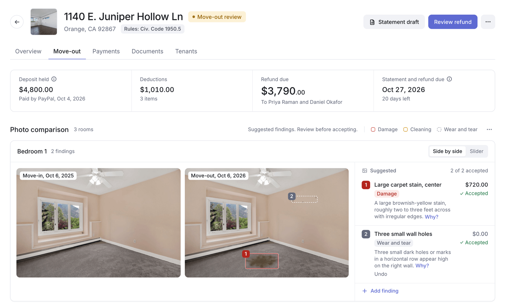
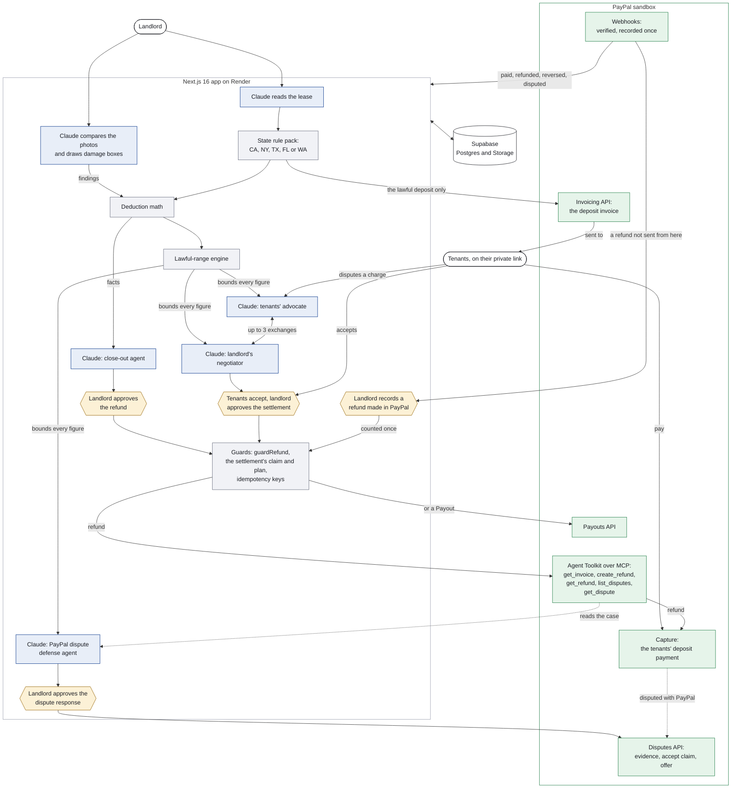

# Good Faith

[](https://github.com/andrewleal0412-arch/good-faith/actions/workflows/checks.yml)

**Security deposits closed out the lawful way: Claude reads the lease and the photos, code computes every dollar from the state's statute, and PayPal returns the money only after a person approves.**

For small landlords (one condo, a duplex, an ADU) and their tenants in California, New York, Texas, Florida and Washington. Built for the [PayPal AI Hackathon](https://paypalaihackathon.devpost.com/). PayPal sandbox only; no real money moves. It informs, computes and drafts; it does not give legal advice.

[Hosted demo](https://good-faith.onrender.com) · Demo video: to be added before submission · [Demo script](docs/DEMO_SCRIPT.md) · [How it works, in detail](docs/HOW_IT_WORKS.md) · [MIT license](LICENSE)

## What it does

1. **Lease.** Claude reads the lease; code flags what breaks the law, and PayPal invoices the lawful deposit only.
2. **Photos.** Claude compares each room's move-in and move-out photos and boxes every change. Wear and tear is never charged.
3. **Deductions.** Code computes every deduction from the invoice or the landlord's hours, prorated, under the state's documentation rules.
4. **Refund.** The close-out agent checks the deposit with PayPal and proposes the refund through PayPal's Agent Toolkit over MCP.
5. **Dispute.** The tenants' advocate and the landlord's negotiator, Claude agents, trade offers inside a lawful range code computed first.
6. **PayPal's side.** Verified webhooks, a defense agent for PayPal disputes, and a refund made in PayPal's dashboard counted once.




<sub>Both pictures are written by the end-to-end test on a production build (`readme-*.png` in its `--shots` folder) and copied in from a run; the live demo fills the same screens with real Claude and PayPal sandbox calls.</sub>

## Try it

[good-faith.onrender.com](https://good-faith.onrender.com) runs in the PayPal sandbox. Enter the access code from the submission's testing instructions. Your browser gets its own private copy of a small landlord, Harbor View Rentals, dated that day, with a welcome card and a short tour of Properties on the first visit, and a demo guide above each page that lists these eight beats and ticks them off. The server stays awake (Render's paid plan), so the first page is a normal page load.

1. **Lease check.** Check a lease, then Check the sample lease: one click, from the facts Claude read when the demo was built, and the code flags a deposit over the cap, a "nonrefundable" fee, and the lawful amount to collect. To watch Claude read it live (about 20 seconds), open the sample from the link beside the button and drop the PDF on the page.
2. **Deposit by PayPal.** Properties, then 1140 E. Juniper Hollow Ln, Overview: the signed refund agreement and the deposit paid through a PayPal invoice.
3. **Move-out boxes.** The same unit's Move-out tab: the photo pairs, Claude's boxes, and the three deductions computed in code, the carpet prorated by its age.
4. **Refund approval.** Review refund, then Prepare refund (under 60 seconds), then Send refund: $3,790.00 back through PayPal's Agent Toolkit, and the receipt shows PayPal's refund id.
5. **Tenant dispute.** On the receipt: Send statement, Record delivery, Open the tenant's view. On the tenants' page: Dispute it, pick the carpet, say why, Ask my advocate (about 60 seconds), Send.
6. **Two-agent negotiation.** Back on the Move-out tab, Let my negotiator answer: the two agents take turns, up to three exchanges, each turn checked by code before either page shows it.
7. **PayPal settlement.** Accept settlement on the tenants' page, then Approve and pay on the property: PayPal refunds the agreed amount against the same deposit payment, and the statement becomes the amended statement.
8. **Multi-state.** Properties, then 2317 Mesquite Bend Dr, Unit 3, in Austin: the same engine under Texas law, with the "Rules: Tex. Prop. Code ch. 92" chip under the address.

482 N. Glassell St, Unit B shows a finished one: a dispute settled at $270.00 back in two exchanges, a recorded example marked "Demo example". Start over, in the account menu, gives your browser a fresh copy. The full walk, the daily limits and the demo data are in [docs/HOW_IT_WORKS.md](docs/HOW_IT_WORKS.md#the-hosted-demo).

## See it for yourself

Three things to check inside your copy, under a minute each.

- **The grid refuses 12 years.** Right after beat 3, before the refund is sent (once it is sent the deductions are final): on the Move-out tab, in Deductions (a window at least 1024 px wide), click the carpet's Life cell and type 12. The cell keeps a red border and a tip reads "Not saved", "Over the lawful range: the guidance uses a 10-year life for this item, so at 6 years old it comes to $720.00 at most.", then "DRE guide p. 84 (guidance, not statute)" and a line saying Escape keeps the saved value.
- **One refund id in two places.** After beat 4, the receipt's "PayPal refund ID" row holds the id with a copy button. Open Payments in the sidebar and click the Refund row for 1140 E. Juniper Hollow Ln: its details panel lists the same id, labelled Refund, under PayPal, with "Status from" saying where its status came from. On both screens, open "PayPal's record": PayPal's own answer for the refund, read from PayPal when you open it, with Check again.
- **The range a turn was checked against.** After beat 6, every turn in the thread carries a green Checked mark; open it for what code held the turn to, and what it changed when it changed anything. Then open a turn's "Reasoning and figures": the agent's reasoning, then each charge with what it keeps of the charge's amount. Why? beside a charge's reason gives the most the law and the record support for it, with the citation, which is the ceiling the turn was held to.

## Against the judging criteria

| Criterion | Where to look |
|---|---|
| Technical implementation of PayPal + AI | Claude agents call PayPal's Agent Toolkit as an MCP server inside the app's process; Invoicing, refunds, Payouts, verified webhooks and the Disputes API with multipart evidence ([`agent.ts`](src/lib/agent.ts), [`paypal.ts`](src/lib/paypal.ts)). |
| Design | White, neutral grays, one navy, legal detail behind tips; WCAG 2.2 AA at 1280 and 390 px, held by a script ([docs/DESIGN.md](docs/DESIGN.md), [docs/ACCESSIBILITY.md](docs/ACCESSIBILITY.md)). |
| Impact | About 70 percent of U.S. rental properties, and 70 percent of the units in properties of one to four units, belong to individual investors, not companies ([HUD and the Census Bureau, 2021 Rental Housing Finance Survey](https://archives.hud.gov/news/2022/pr22-242.cfm)); a California superior court's self-help page calls the refund of the deposit after move-out "the most common disagreement between landlords and tenants" ([San Mateo Superior Court, small claims](https://sanmateo.courts.ca.gov/self-help/small-claims-self-help/common-types-small-claims-cases-special-rules)). Five states' deposit law in one engine, for those landlords and the tenants whose money it is ([the problem](docs/HOW_IT_WORKS.md#the-problem)). |
| Innovation | Two agents negotiating for two humans inside a range code computed from the statute, each turn checked before anyone sees it, and PayPal paying only when both humans say yes. |
| Presentation | A private demo copy per judge, a [demo script](docs/DEMO_SCRIPT.md) beat by beat, and an end-to-end test that walks it on a production build ([Checks](#checks)). |

### Best Use of PayPal + AI

- Claude never decides an amount. It reads the figures code computed, then calls PayPal's own tools: `get_invoice`, `create_refund`, `get_refund`, and `get_dispute` in a PayPal dispute. The refund review and the receipt name the close-out's three tools beside the steps that called them, with a tip on what each did.
- `create_refund` is wrapped so it waits for the landlord and passes `guardRefund`, which reads the database and PayPal again and refuses any other rail, amount, payment or account.
- The same rail rule sends the close-out and a settlement against the original payment inside PayPal's 180-day window, else as a Payout to the account the tenants named in writing ([`refund-rail.ts`](src/lib/refund-rail.ts)).
- Every refund and Payout carries an idempotency key from the app's own records, so a retry after a lost answer gets the first result back.
- Webhooks and every live read of the invoice feed back in, so a refund made in the PayPal dashboard is found and held for the landlord's decision, and the same money never goes back twice.

### Best Use of Agentic Commerce

- The close-out agent runs the refund end to end with a step limit, pauses on every money tool, and resumes only after an approval claimed once in the database ([`agent.ts`](src/lib/agent.ts)).
- The negotiator works under a policy the landlord sets: concede what the law and the record don't support, and ask before giving back more than a private limit ([`negotiator.ts`](src/lib/negotiator.ts)).
- The advocate works for the tenants, held to the same lawful range, so planted words in a dispute can change wording at most, never money ([`advocate.ts`](src/lib/advocate.ts)).
- The defense agent may never argue for keeping money the law says goes back ([`chargeback.ts`](src/lib/chargeback.ts)).
- The settlement pays once, on a plan recomputed from the database and PayPal right before the call ([`settlement.ts`](src/lib/settlement.ts)).

### AG Grid sponsor prize

- Three grids and four charts from the free Community builds (`ag-grid-community` and `ag-grid-react` 36.2, `ag-charts-community` and `ag-charts-react` 14.2): no Enterprise module, no license key.
- One Quartz theme set from the design tokens through the Theming API ([`grid.tsx`](src/components/grid.tsx)); each grid is one Tab stop from the keyboard.
- Deductions, edited in place: the landlord edits the inputs, never the amount, and every keystroke runs the server's own check against the lawful range ([`deductions-grid.tsx`](src/app/%28landlord%29/tenancy/%5Bid%5D/deductions-grid.tsx)).
- Payments: every invoice, payment, deduction, refund, settlement and payout, with saved views, a remembered column layout, a details panel per row and a CSV a spreadsheet can't run as formulas ([`ledger-grid.tsx`](src/app/%28landlord%29/ledger/ledger-grid.tsx)).
- Insights: the portfolio grouped by state with pinned totals and four AG Charts from the ledger's own rows, so Payments, Insights and Properties agree ([more](docs/HOW_IT_WORKS.md#built-with-ag-grid)).

### Best Use of Render

- The hosted demo is one Render Blueprint ([`render.yaml`](render.yaml)): a Node web service and a cron job, every variable `sync: false`, so the file sits in the public repo and holds no secret.
- The web service runs one instance by design (the access gate's wrong-code count lives in memory), on Render's paid plan, which does not sleep, in the Render region paired to the Supabase project's; Render checks [`/api/health`](src/app/api/health/route.ts), whose public answer says the server is up and nothing else.
- The cron job, `good-faith-sweep`, runs `npm run demo:sweep -- --apply` every morning: each judge's private copy older than 14 days is removed with its rows and its files, so the demo cleans up after itself ([`demo-sweep.mjs`](scripts/demo-sweep.mjs)).
- The caller's address comes from `CF-Connecting-IP`, which Render's Cloudflare edge sets and a caller can't forge ([`access-throttle.ts`](src/lib/access-throttle.ts) reads it); the gate's wrong-code limit, the per-address limit on new copies and the webhook route's rate limit all count by it. The app sends its pages uncompressed and leaves Brotli and gzip to that edge (`compress: false` in [`next.config.ts`](next.config.ts)).
- Render sets no per-route time limit, so a Claude inspection or a close-out run takes as long as Claude does. The deploy, the judging-window checklist and the ten-minute check after a deploy are in [docs/DEPLOY.md](docs/DEPLOY.md).

## Architecture

One Next.js 16 app (App Router, TypeScript, Tailwind 4) on Render, with Supabase for the data and the files. Navy boxes propose (Claude), gray boxes decide (code), amber boxes are a person's approval, and green boxes are PayPal.



| Piece | What it does here |
|---|---|
| **Next.js 16** (App Router, TypeScript, Tailwind 4) | Server components read the database; route handlers under `src/app/api` do the writes and the money. The access gate is `src/proxy.ts`. |
| **Claude** (Opus 5.5 through the AI SDK, `ai` v7 and `@ai-sdk/anthropic`) | Six jobs: lease extraction and photo inspection with `Output.object` and a Zod schema; the close-out agent with tools, a step limit and `needsApproval` on every money tool; the advocate and the negotiator held to the lawful range; the PayPal dispute's defense agent, which stops at its proposal ([`model.ts`](src/lib/model.ts)). |
| **Jev by TypeSafe** (`@typesafe-ai/sdk` 0.6.0) | Optional, and off without `TYPESAFE_API_KEY`. With the key, it reads a finding's words as the landlord types them and checks the agents' reasons against the record ([details](docs/HOW_IT_WORKS.md#jev-optional)). |
| **PayPal** | Invoicing, the Agent Toolkit over MCP (`@paypal/agent-toolkit` 1.11.0 through `@ai-sdk/mcp`), Payouts, the Disputes API and webhooks, all in the sandbox ([`paypal.ts`](src/lib/paypal.ts), [`agent.ts`](src/lib/agent.ts), [`paypal-webhook.ts`](src/lib/paypal-webhook.ts)). |
| **Supabase** | Postgres and three private Storage buckets. The server uses the secret key with row level security on and no policies, and every query is scoped in code to the session's workspace ([`workspace.ts`](src/lib/workspace.ts)). Row-locking functions make the concurrent writes atomic. |
| **Render** | The hosted demo: one Blueprint with the web service and the daily sweep cron, behind Render's Cloudflare edge ([Render](#best-use-of-render)). |
| **AG Grid and AG Charts Community** | The deductions, Payments and Insights grids and the four charts ([AG Grid](#ag-grid-sponsor-prize)). |
| **pdf-lib and sharp** | The statement's PDF packet with the photo exhibits and invoices; the photos' 480 px thumbnails. |

Every part in more depth, one refund step by step, and where things live in the tree: [docs/HOW_IT_WORKS.md](docs/HOW_IT_WORKS.md#architecture-piece-by-piece).

## Safety design

- **No legal advice.** The app informs, computes, drafts and asks people to approve; citations come only from the rule pack, never from a model's memory.
- **Money math in code.** The cap, each deduction, the refund plan, the deadlines and each charge's lawful range are plain code from the state's rule pack, and every figure an agent proposes is checked against them.
- **Nothing moves until the landlord approves.** The refund, a settlement (after the tenants accept) and a PayPal dispute response are each claimed once in the database, so a double click pays or sends once.
- **Guards at the moment of the call.** `guardRefund` recomputes the rail, amount, payment and account from the database and PayPal right before PayPal is called, and every refund and Payout carries an idempotency key.
- **Sandbox only.** A `LIVE` PayPal environment is refused until the app has a landlord sign-in, and the app never holds funds.
- **Isolation.** Every read and write is scoped to the session's workspace, a demo copy refunds only a deposit it owns, and every action goes to an audit log.

## States

The property's state picks its rule pack ([`src/lib/states/`](src/lib/states/)), and every number, deadline, notice, document rule, refund-method rule, penalty and citation comes from it. The engine, the PayPal rails and the guards are the same for all five.

| State | Statute | Deadline | Cap |
|---|---|---|---|
| California | Civ. Code 1950.5 | 21 days after move-out | 1 month (2 for a small landlord) |
| New York | N.Y. GOL 7-108 | 14 days after the tenants vacate, or every deduction is forfeited | 1 month |
| Texas | Tex. Prop. Code ch. 92 | 30 days after surrender, owed once a written forwarding address arrives | None |
| Florida | Fla. Stat. 83.49 | 15 days with no claim; a claim notice within 30 days | None |
| Washington | RCW 59.18.280 | 30 days after the tenancy ends and the tenants vacate | None |

City rules are shown as warnings only, never enforced. Sources, time zones and known gaps: [docs/rules/README.md](docs/rules/README.md) and [docs/LEGAL_RULES.md](docs/LEGAL_RULES.md).

## Checks

The badge at the top of this file is [GitHub Actions](.github/workflows/checks.yml) running `tsc`, `eslint` and fourteen check scripts (2,044 assertions) on every push. Three browser walks run by hand on a production build with Claude and PayPal stubbed: `scripts/e2e-demo.py` walks the eight beats of the demo script in Chromium and checks every dollar figure on the way, `scripts/a11y-check.py` holds every page to WCAG 2.2 AA at 1280 and 390 px, and `scripts/align-check.py` measures every icon, dot, tile and badge against the text beside it at both widths.

```bash
python scripts/e2e-demo.py --worktree <a new dir> --shots <dir>    # the judges' path end to end
python scripts/a11y-check.py --worktree <a new dir> --shots <dir>  # WCAG 2.2 AA on every page
python scripts/align-check.py --worktree <a new dir> --shots <dir> # every mark centered on its text
```

| Check | Result | Run by |
|---|---|---|
| `tsc`, `eslint --max-warnings=0` | Clean | CI, every push |
| `state-packs` 316, `zone` 118, `lawful-range` 147, `negotiation` 136, `paypal-webhook` 168, `grid` 70, `demo-welcome` 25, `chargeback` 121, `jev` 166, `reconcile` 87, `cache` 295, `thumbs` 169, `e2e-stubs` 62, `page-weight` 164 | All passed | CI, every push |
| `ca-snapshot.mjs` | Identical, 17 sections | By hand, 2026-10-16 |
| `clipboard-check.py` on a production build | 8 of 8 | By hand, 2026-10-15 |
| `e2e-demo.py` on a production build | 150 of 150 | By hand, 2026-11-02 |
| `a11y-check.py` on a production build | 397 of 397, no serious or critical axe violation | By hand, 2026-11-02 |
| `npm audit --omit=dev --audit-level=critical` | Clean; 12 advisories below critical, in the toolkit's tree and `zod` 3 ([Security](#security)) | By hand, 2026-11-02 |
| `align-check.py` on a production build | 8 of 8: 2,319 marks beside text, 919 glyphs in frames and 698 labels in boxes on 102 views, none off by more than 0.75 px | By hand, 2026-11-01 |

What each script checks, and how the end-to-end test builds and stubs: [docs/HOW_IT_WORKS.md](docs/HOW_IT_WORKS.md#checks-and-the-end-to-end-test).

## Known limits

- **Sandbox only.** Live PayPal is refused until there is a per-landlord sign-in; the hosted demo's shared access code is not one.
- **Five states, statutes only.** Other states are refused. City rules are warnings, and some rules in the verified state specs are not in code yet ([known gaps](docs/rules/README.md#known-gaps)).
- **One small server.** The hosted demo is one Render instance with half a CPU (Render's paid plan, which does not sleep), and every page is rendered on it; the screens that read PayPal live before they show (the statement, the refund review) are the slow ones.
- **Daily limits.** The advocate runs three times a day per unit and the negotiator three times a day per browser; if the day's pre-paid sandbox deposits run out, the Review refund page says so and the rest of the copy still works.
- **Demo data.** The Texas deposit is dated after its notice, since PayPal dates the sandbox payment the day the demo was built, and the closed unit's settled dispute is a recorded example with no PayPal money behind it.

The full list, with PayPal's tool gaps, accessibility's open items and the dependency advisories: [docs/HOW_IT_WORKS.md](docs/HOW_IT_WORKS.md#known-limits).

### Security

`npm audit --omit=dev` (2026-11-02) lists 12 vulnerable packages (11 high, 1 moderate, none critical): the toolkit, `@paypal/agent-toolkit` 1.11.0, with ten of its own dependencies, and `zod` 3, which the app and the toolkit (`^3.24.2`) both declare. The app loads only the toolkit's MCP entry, `@paypal/agent-toolkit/mcp`. That entry never loads `@langchain/core`, `langsmith`, `uuid`, `jsondiffpatch`, `openai` or the nested `ai` 4 and AI SDK packages; those belong to its LangChain and AI SDK entries. It loads `mathjs` only to round invoice totals. npm's only fix for those is a downgrade to the toolkit's 1.3.5, a breaking change, and the `mathjs` fix (15.2.0) is outside the toolkit's `^14` range. The `zod` advisory (a large array sent to a schema with no length limit exhausts memory) is fixed in zod 4, outside the toolkit's range; the app's own schemas read Claude's structured output and one signed-in route's JSON body, which `src/proxy.ts` caps at about 4.5 MB and whose arrays all carry `.max()`. Everything else `npm audit` had come to list by 2026-11-02 was moved to its fixed release that day, with no breaking change: Next.js 16.4.4 (two critical and one high advisory in 16.0.0 to 16.4.0), `undici` 7.30.1, `@modelcontextprotocol/sdk` 1.32.2 and six packages beneath the MCP SDK and the toolkit, so `npm audit --omit=dev --audit-level=critical` is clean. The rest of `npm audit` is lint tooling. Dependabot will list the same advisories, plus the lint tooling's.

## Setup

`npm install`, the four `scripts/setup-*.sh` scripts, then `npm run dev -- -p 3210`. The variables, the migrations and the demo seed are in [docs/HOW_IT_WORKS.md](docs/HOW_IT_WORKS.md#setup); hosting is in [docs/DEPLOY.md](docs/DEPLOY.md).

## License

MIT, see [LICENSE](LICENSE).
