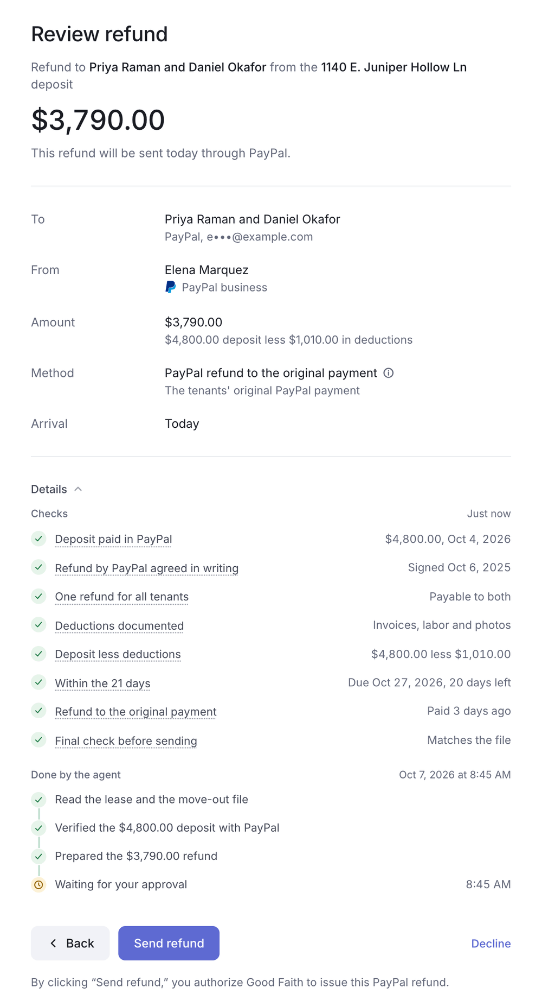
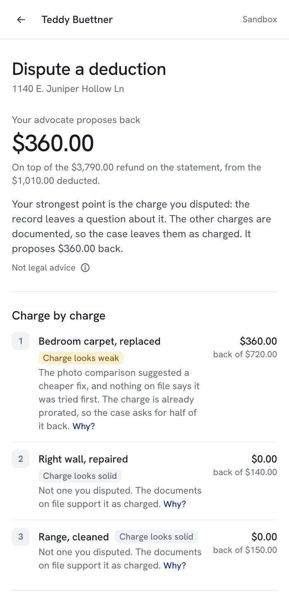
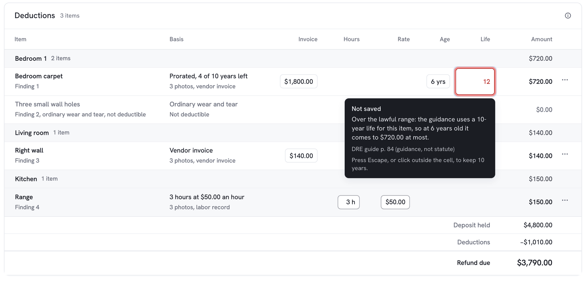
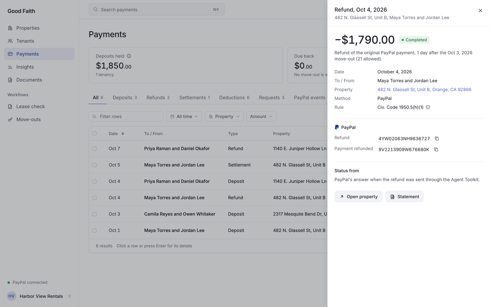
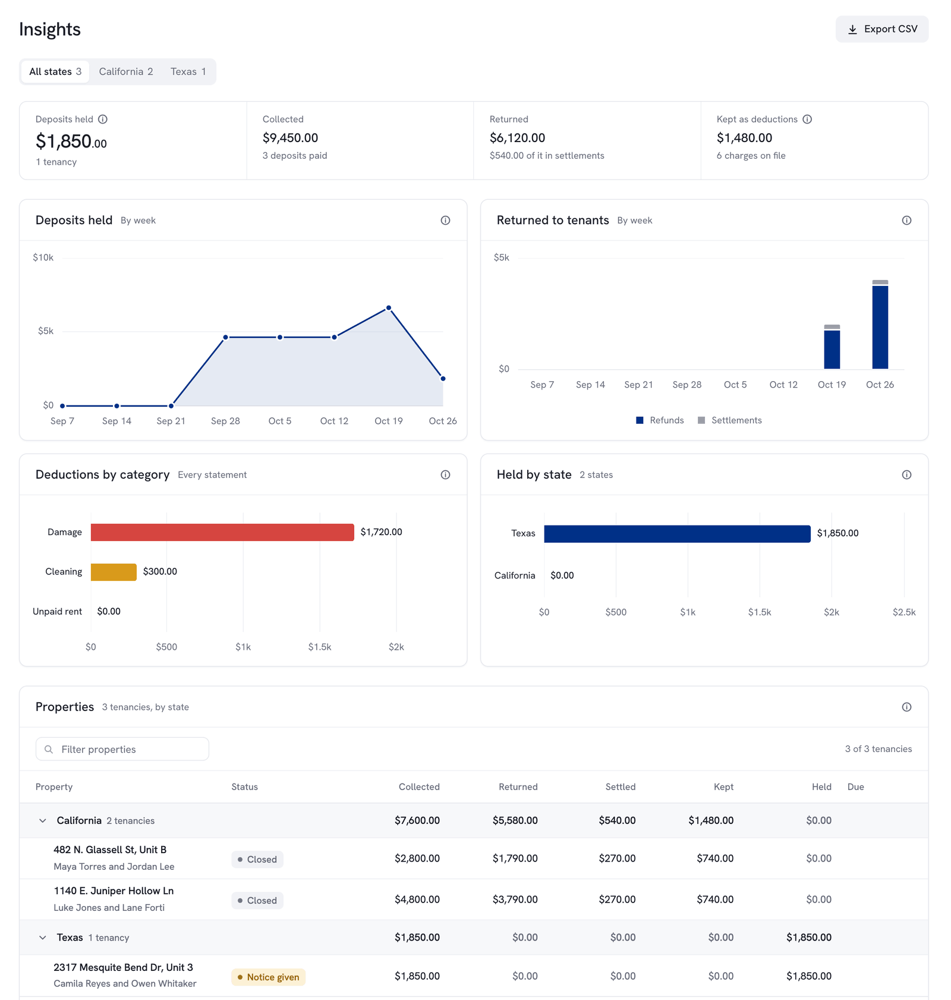
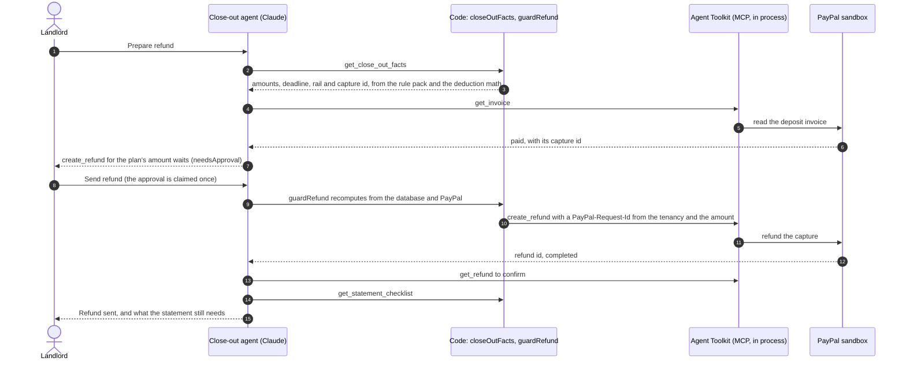
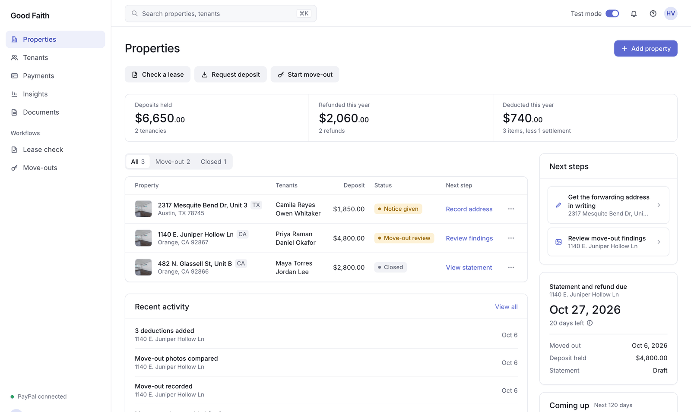

# How Good Faith works, in detail

The README is the short version for a first read. This page is the long one: every step of a tenancy, how the work is split between Claude and code, the disputes and the PayPal chargebacks with what ran against the sandbox, the AG Grid screens, the architecture piece by piece, the five states and the legal sources, the hosted demo, the checks, the full list of known limits, setup and the demo scripts. Back to the [README](../README.md).

## The problem

Most rental properties in the United States are held by people, not companies: about 70 percent of rental properties, holding 38 percent of all rental units, belong to individual investors, and so do 70 percent of the units in properties of one to four units ([HUD and the Census Bureau, 2021 Rental Housing Finance Survey, November 29, 2022](https://archives.hud.gov/news/2022/pr22-242.cfm); the decimals, 70.2 and 37.6, are in [CRS report R47332](https://www.congress.gov/crs_external_products/R/HTML/R47332.html)). When a deposit goes wrong, the usual forum is small claims court: the San Mateo Superior Court's self-help page calls the refund of the deposit after move-out "the most common disagreement between landlords and tenants" ([Common types of small claims cases](https://sanmateo.courts.ca.gov/self-help/small-claims-self-help/common-types-small-claims-cases-special-rules)). California rewrote the security deposit rules four times in three years, and the people most likely to get them wrong are landlords with one unit who keep everything in texts and Venmo screenshots. The rules the app enforces (all citations are to Civil Code 1950.5; the full spec is [LEGAL_RULES.md](LEGAL_RULES.md)):

- **The cap.** Security is everything charged at the start of the tenancy except first month's rent, however it is labeled, and it may not exceed one month's rent. A landlord who is a natural person (or an LLC of natural persons) with no more than two rental properties and four units may take two months. (a), (b), (c)(1), (c)(5), AB 12, for deposits demanded on or after July 1, 2024. No part of it may be called nonrefundable, (n).
- **Photos.** For tenancies that began on or after July 1, 2025, the landlord must photograph the unit at move-in, (g)(1). For any repair or cleaning deducted after April 1, 2025, photos before the work and after it, (g)(2). AB 2801. Without them, the documentation the statement must include, (h)(2)(D), cannot be met.
- **Electronic refunds.** Since January 1, 2026, a landlord who received the deposit or rent electronically must refund the deposit electronically, to an account the tenant designates or "by any electronic or virtual method available to the landlord if agreed to in writing by the tenant", (h)(1)(A), AB 414. PayPal qualifies only with that written agreement, so the app records it at move-in. The statute also calls for a written notice of the right to an electronic refund after notice to terminate, (h)(1)(A)(ii)(II), unless the parties already agreed in writing on the method of return; the app treats the signed PayPal agreement as that agreement and drafts the notice when there is none.
- **21 days.** The itemized statement and the refund are due within 21 calendar days after the tenant vacates, (h)(1), with the invoices, receipts, labor time and rates, and the photos attached, (h)(2)(A)-(D), unless repair and cleaning deductions total $125 or less, (h)(4).
- **The penalty.** Bad-faith retention can cost up to twice the deposit in statutory damages on top of actual damages, and the landlord bears the burden of proving every deduction was reasonable, (h)(7), (m).

California is the deepest pack and the one the demo walks through. New York, Texas, Florida and Washington run on the same engine with their own deadlines, documents and penalties; see [States](#states).

## How it works

1. **Check the lease** (`/lease`, "Check a lease" in the sidebar). Upload the lease PDF, or check the sample lease in one click (the facts Claude read from `demo/lease-single-owner.pdf` when the demo was built, `src/lib/demo-lease.ts`: no Claude call). Claude extracts the deposit terms as facts with the exact wording it relied on (`src/lib/extract.ts`); the rules engine (`src/lib/rules.ts`) flags violations, warnings and required steps with the statute beside each flag, and computes the lawful deposit.
2. **Start the tenancy** (`/tenancy/[id]`). The property, tenants, rent and terms are saved with every flag. In a private copy of the demo a lease that already has a tenancy there (the same address and the same tenants, `src/lib/lease-key.ts`) opens that tenancy instead of starting a second one of it, and says so in one line. Each property opens on a record header (photo, address, status, the statement and the one primary action) over five tabs: Overview, Move-out, Payments, Documents and Tenants.
3. **Move-in.** The tenants agree in writing that the refund comes back by PayPal (AB 414). The agent sends a PayPal invoice for the lawful amount, capped at the statute, and the page shows "Paid" the moment PayPal does. Move-in photos go in room by room.
4. **The tenants' private link** (`/t/<token>`). A page for the tenants: what they paid, the agreement, the move-in photos, a form to say they are moving out with the forwarding address the statement is mailed to, and the statement once it is delivered. The token is hashed in the database and can be revoked. The link's routes that build per request (the statement packet, a photo at full size) count their callers by address and refuse a flood before any read (`src/lib/rate-limit.ts`); the page's own thumbnails don't count.
5. **Notice.** When the tenants give notice, the app records the planned move-out, drafts the initial-inspection notice, (f)(1), and the electronic-refund notice when one is owed, and offers an `.ics` file with the window, the move-out and the 21-day deadline.
6. **Move-out.** Photos of each room before any repair or cleaning. Claude compares them with move-in, room by room, and classifies each change as wear and tear (never chargeable), damage, cleaning, or unclear (`src/lib/inspect.ts`). It classifies; it does not price.
7. **Deductions.** One form per finding. The landlord enters the facts (a vendor invoice or own hours and rate, the item's age, the receipt, the after-repair photos) and the code computes the amount with useful-life or paint-schedule proration from the DRE guide, marks estimates under (h)(3), and tracks the $125 documentation rule (`src/lib/deductions.ts`). On the Move-out tab the deductions sit in an AG Grid by room, and each input can be changed in its cell: the amount is worked out again by the same code, held to the charge's lawful range as it is typed and again by the server (see [Built with AG Grid](#built-with-ag-grid)).
8. **Close out.** The agent (`src/lib/agent.ts`) reads the close-out facts from the rules engine, confirms the deposit invoice with PayPal, proposes the refund on the rail the rules allow (a refund of the original payment inside PayPal's 180-day window, otherwise a Payout), waits for the landlord's approval, sends it, confirms the refund, and grades the statement against the 13-item checklist. A refund of the whole deposit (nothing deducted, or New York's deductions forfeited) carries code's note saying so, never "less itemized deductions".
9. **The itemized statement.** A statement page and a one-click PDF packet with the photo exhibits and vendor invoices (`src/lib/statement.ts`, `src/lib/statement-pdf.ts`), plus a delivery record: personal delivery, first-class mail, or email by written agreement, (h)(1)(B), (h)(6). A delivery recorded on a later day than the date it names (handed over Friday, recorded Monday) shows "recorded <date>" beside that date on the statement, its PDF and the tenants' page (`statement_delivery_recorded_at`). A correction that keeps the date (a fixed address) keeps the first recording.
10. **Properties** (`/units`, the landlord's home; `/` opens it). Every tenancy, what it holds, its status and the next thing the law asks for, worked out from the dates, with the deposits held, refunded and deducted this year, recent activity, the next steps and the nearest 21-day deadline. Tenants, Documents and Move-outs list the same tenancies by person, by paper and by deadline.
11. **Payments** (`/ledger`). Every deposit invoice, payment, deduction, refund and payout across every unit in one AG Grid, each row tagged with the part of Civil Code 1950.5 that applies to it ((b)(2) damage, (h)(1) 21 days, and so on, with the subsection's words on hover and in the CSV). Saved views (All, Deposits, Refunds, Settlements, Deductions, Requests, PayPal events), a quick filter, filter chips, sorting, a column layout remembered per browser, a details panel per row with every PayPal id behind it, and a CSV that respects the filters. "Still held" is what was collected, less the deductions on a statement that has gone out and less what went back: drafts take nothing out yet, a refund PayPal refused moved nothing, and each tenancy is clamped at zero on its own, so the figure agrees with the Properties page. A New York deduction forfeited after day 14 is marked "Forfeited after day 14" and counts as neither deducted nor kept, here, in Insights and in Properties' "Deducted this year". Each tenancy page carries its own money timeline with a way into the ledger filtered to that tenancy (not its address, so a re-let unit never shows the previous tenants' money) (`src/lib/ledger.ts`, `src/app/(landlord)/ledger/`).

12. **Disputes** (`/t/<token>/dispute`). Once the statement is out, the tenants can dispute deductions from their link: pick the charges, say why, add photos, and ask their advocate, a Claude agent working for them, to write their case from the statement, the photos and the comparison's boxes, the deduction math and documents, and the state's rules. Code computes each charge's lawful range first (`src/lib/lawful-range.ts`: $0 and "unlawful" for wear and tear, a state bar, or every charge after a late statement that forfeits on every reading of the dates; $0 and "unsupported" for a charge missing the documents California requires, which the landlord can still supply; the guidance-prorated value for an over-long useful life), and the advocate's case is held to it: no amount outside the range, "unlawful" or "unsupported" only where the code says so, citations only from the pack, and wording that goes past informing (suing, courts, who would win) replaced with the code's own. The tenants send the advocate's case only while it matches their reasons; otherwise they send their reasons on their own. While a sent dispute is open, the statement's deductions can't be added or removed. Sending it opens the dispute on the property's Move-out tab, with a banner on every tab. The tenants may withdraw a sent dispute (not while the agents run, after they accepted a settlement, or while its payment is out), and a withdrawn dispute can be opened again from their link as a new dispute of the same statement; a settled dispute, and one that ended with no agreement, stay closed (`src/lib/dispute-status.ts`, `withdraw_dispute` in the database).
13. **Negotiation and settlement.** On the Move-out tab the landlord sets a policy for its own negotiator, a Claude agent working for the landlord (`src/lib/negotiator.ts`): concede automatically what the law and the records don't support, and ask before giving back more than a set amount. "Let my negotiator answer" starts the two agents: the negotiator answers the tenants' case charge by charge with the landlord's evidence (concede, hold or counter, each with a reason and a citation from the pack), the tenants' advocate answers back, and so on for at most three exchanges. Code checks every turn before anyone sees it: each figure inside the charge's lawful range, every counter between the two sides' last figures so nobody takes back a concession, the landlord's limit (kept private from the tenants), citations from the pack and wording that informs. The loop stops early when both sides' figures give back the same amount or when an exchange moves neither side, and each turn appears on both pages as it is made, with its reasoning. A settlement takes effect only when the tenants accept it on their link and the landlord approves it ("Approve and pay"); then the agreed amount goes back on top of the statement's refund (`src/lib/settlement.ts`). It uses the same PayPal Agent Toolkit over MCP and the same rail rule as the close-out (`src/lib/refund-rail.ts`: a partial refund of the original payment while it is inside PayPal's window and enough of it is left, else a Payout to the account the tenants named), with its own guard rather than the close-out's `guardRefund`: a claim in the database, so a double click pays once and only after both humans said yes, then a plan recomputed from the database and PayPal's live state right before the call, which refuses a deposit the workspace doesn't own, PayPal unreachable, and a statement whose own refund hasn't gone yet. The close-out's other blockers limit what a landlord may keep, so they don't stop a settlement, which only gives more back. Every attempt carries an idempotency key (PayPal-Request-Id, or the Payout's batch id): if PayPal never answers, the settlement is frozen (no offer, acceptance or new attempt can touch it) until "Check with PayPal" sends the same request again, and PayPal answers with the first payment if it went or makes it once if it didn't. The statement and its PDF become the amended statement (the original deductions, the agreed adjustment, the new totals, who accepted and approved it and when, the PayPal id), the ledger shows a Settlement row, and the tenants' page shows the settled amount. Without agreement, both final positions are recorded, the tenants' page says plainly what the state's process is (the pack's forum, with its citation, never advice), and either side can still make its own offer. Where the state forfeits the deposit over a late statement on every reading (New York after day 14, Washington), every charge's range is $0; in New York, whose statute names no defense, the landlord's side concedes it all in code, with the rule's citation and no model call. A New York close-out after day 14 with a dispute open returns the whole deposit, so its settlement moves no more money.

14. **PayPal disputes and chargebacks.** When the tenants dispute the deposit payment with PayPal itself, PayPal's webhook (or Check PayPal, which asks the Disputes API through the Agent Toolkit) puts the dispute on the property: a red PayPal dispute chip on Properties, a banner on every tab, the bell, and a card on the Payments tab with PayPal's reason, amount and date and the tenants' own words. The defense agent prepares the landlord's response, held to the lawful range, and nothing goes to PayPal until the landlord approves that exact response. See [Chargebacks](#chargebacks).
15. **Refunds made in PayPal.** A refund of the deposit payment the landlord made in the PayPal dashboard (or one sent from here whose answer was lost) reaches the app through PayPal's webhook or the invoice's own list of refunds on any live read, and is kept once per tenancy, whichever saw it first. The property shows it with its amount, day and PayPal id, and the landlord records it as this deposit's refund or marks it not this deposit, one click each; nothing is recorded on its own, and until then the close-out and a settlement wait. Recorded, it counts once wherever the app's own refunds count: the close-out sends only what is still owed (`guardRefund` included), and the statement and its PDF, the tenants' page, Payments, Insights, Properties, the activity and the audit log all carry it (`src/lib/reconcile.ts`, `src/lib/outside-refunds.ts`).
16. **Insights** (`/insights`). The portfolio in numbers: what is held now, collected, returned and kept, four charts (deposits held and money returned over time, deductions by category, held by state) and every property in a grid grouped by state, from the same ledger rows as Payments, so the figures agree (`src/lib/insights.ts`, `src/app/(landlord)/insights/`).

Every action, by whom and with what, is written to an audit log the tenancy page shows.


<p>


</p>

<sub>Screenshots from the end-to-end test on a production build (2026-10-07); the live demo fills the same screens with real Claude and PayPal sandbox calls.</sub>

## PayPal and AI, step by step

AI proposes, code decides, a person approves, and PayPal moves the money. Each step of a tenancy:

| Step | AI proposes | Code decides | A person approves | PayPal |
|---|---|---|---|---|
| Lease | Claude reads the deposit terms, with quotes ([`extract.ts`](../src/lib/extract.ts)) | The rule pack flags violations and computes the lawful deposit ([`rules.ts`](../src/lib/rules.ts), [`states/`](../src/lib/states/)) | The landlord confirms the state and starts the tenancy | Invoicing API: an invoice for the lawful amount only ([`paypal.ts`](../src/lib/paypal.ts)) |
| Move-out | Claude boxes each change on the photos ([`inspect.ts`](../src/lib/inspect.ts)) | Every deduction, prorated, with the documentation rule ([`deductions.ts`](../src/lib/deductions.ts)) | The landlord accepts each finding and enters the costs | None |
| Refund | The close-out agent proposes the refund with PayPal's tools ([`agent.ts`](../src/lib/agent.ts)) | The plan and the rail ([`closeout.ts`](../src/lib/closeout.ts), [`refund-rail.ts`](../src/lib/refund-rail.ts)); `guardRefund` recomputes it at the moment of the call | Send refund (`needsApproval` on every money tool) | Agent Toolkit over MCP: `get_invoice`, `create_refund`, `get_refund`; Payouts when the payment can't be refunded |
| Statement dispute | The tenants' advocate and the landlord's negotiator negotiate ([`advocate.ts`](../src/lib/advocate.ts), [`negotiator.ts`](../src/lib/negotiator.ts)) | Each charge's lawful range, and every turn checked against it ([`lawful-range.ts`](../src/lib/lawful-range.ts)) | The tenants accept, then the landlord approves and pays | A partial refund of the deposit payment through the Agent Toolkit, or a Payout ([`settlement.ts`](../src/lib/settlement.ts)) |
| PayPal dispute | The defense agent reads the dispute through the Agent Toolkit and proposes one response ([`chargeback-agent.ts`](../src/lib/chargeback-agent.ts)) | What is still owed back, so which responses are allowed ([`chargeback.ts`](../src/lib/chargeback.ts)) | The landlord approves that exact response | Disputes API: evidence with the statement and photos, accept claim, or offer ([`chargeback-store.ts`](../src/lib/chargeback-store.ts)) |
| PayPal's own events | None | Verify, record once, match to one tenancy ([`paypal-webhook.ts`](../src/lib/paypal-webhook.ts), [`reconcile.ts`](../src/lib/reconcile.ts)) | The landlord records a refund made in PayPal as this deposit's, or sets it aside | Webhooks: invoice paid, capture completed, refunded or reversed, Payouts, disputes |

**The safety rules, in full.** The model never decides an amount and never moves money on its own.

- **No legal advice.** The app informs, computes, drafts and asks people to approve. Citations come only from the rule pack, never from a model's memory, and wording in an agent's case, turn or dispute response that goes past informing (telling someone to sue, predicting a court) is replaced in code with the app's own. The state's disclaimer is in Help, on the statement, its PDF and the notices, and the tenants' pages say "Not legal advice" ([Legal sources and the disclaimer](#legal-sources-and-the-disclaimer)).
- **Deterministic money math.** The cap, each deduction, the refund plan, the deadlines in the property's own time zone, and each charge's lawful range are plain code ([`rules.ts`](../src/lib/rules.ts), [`deductions.ts`](../src/lib/deductions.ts), [`closeout.ts`](../src/lib/closeout.ts), [`lawful-range.ts`](../src/lib/lawful-range.ts)). The agents are told these facts are authoritative, and every figure an agent proposes is checked against them before anyone sees it.
- **State rule packs with sources.** One engine, five packs ([`src/lib/states/`](../src/lib/states/)), each written from a spec with its sources and rule ids ([California](LEGAL_RULES.md), [the others](rules/README.md)). Any other state is refused by name. California's output is pinned by a snapshot that must stay identical.
- **A person approves before money moves.** The landlord approves the close-out refund; the tenants accept and the landlord approves a settlement; the landlord approves the exact response to a PayPal dispute; and a refund made in PayPal counts only once the landlord records it. The refund, the settlement payment and the dispute response are each claimed once in the database, so a double click pays or sends once.
- **Guards at the moment of the call.** `guardRefund` recomputes the facts from the database and PayPal when the money tool runs and blocks any rail, amount, payment or account that doesn't match. The settlement and the dispute response have their own guards of the same kind. Every refund and Payout carries an idempotency key from the app's own records, so a retry after a lost answer gets PayPal's first result back rather than paying twice; the deposit invoice is made once by its invoice number.
- **Sandbox only.** The deposit invoice, the close-out, the settlement and the dispute response refuse a `LIVE` PayPal environment until the app has a landlord sign-in; the hosted demo's access code is not one ([DEPLOY.md](DEPLOY.md), sections 8 and 9). The app never holds funds: the landlord's PayPal business account does.
- **Isolation.** Each demo visitor works in a private copy, every read and write is scoped to the session's workspace, nothing kept between requests can carry one workspace's data to another, and a copy refunds only a deposit it owns ([`workspace.ts`](../src/lib/workspace.ts), [`demo-pool.ts`](../src/lib/demo-pool.ts), `scripts/cache-check.mjs`). Every action is written to an audit log with who did it.

## How the work is split up

Claude reasons and writes. Code enforces the law and moves the money.

| Part | What it does here | Where |
|---|---|---|
| **Claude** (Opus 5.5, through the AI SDK) | Reads the lease and the photos, and writes: the close-out agent's proposal, the tenants' advocate's case, each negotiation turn, the PayPal dispute's response | `extract.ts`, `inspect.ts`, `agent.ts`, `advocate.ts`, `negotiator.ts`, `chargeback-agent.ts` |
| **Code** | Every amount, date, deadline, range and limit, and every PayPal call, only after a human approves | `rules.ts`, `deductions.ts`, `lawful-range.ts`, `closeout.ts`, `refund-rail.ts` |

### Jev, optional

Jev by TypeSafe (`jev-1.13.0`, `@typesafe-ai/sdk` 0.6.0, `src/lib/jev.ts`) is a fast model that answers typed questions with a probability for each option. It writes no text, does no arithmetic and sees no photo. It is off without `TYPESAFE_API_KEY`, and the hosted demo does not need it. With the key it does two jobs, one request each.

- **A quick read on Add finding** (`POST /api/tenancies/[id]/findings/classify`). About 400 ms after the landlord stops typing, it reads the words as damage, cleaning, wear and tear or unclear under the state's rules, asked in four option orders and averaged, and a chip under Type says "Reads as wear and tear, 92%, under Civ. Code 1950.5(b)(2), (e)(2)(A)". It picks the Type only when the average's top probability is at least 0.7 and at least 0.6 in the least sure order, and never over the landlord's own pick. A slow (1.5 s) or failed read shows nothing. Without the key the form has the three Type buttons with Damage picked to start, and no chip.
- **A record-support check on the agents' reasons.** After code holds a case or a turn to the lawful range, each reason's claims are checked against that line's record. A reason with a claim the record contradicts, at a probability of 0.5 or more, gives way to the app's own reason, and the turn says so. No amount, verdict or citation moves. Without the key the reasons stand as the agents wrote them, after code's checks.

Only the words a question needs leave the server, with names, addresses, emails and phone numbers taken out. `node scripts/jev-check.mjs --live` ran against the live model on 2026-10-06: the demo's nail holes read as wear and tear at 1.00, the carpet stain as damage at 0.98 and the range as cleaning at 0.91 to 0.92; of 15 accurate reasons none was demoted and every planted false claim was demoted (0.72 to 1.00); a planted "ignore your rules" scored 0.99.

## Disputes and settlement

Two Claude agents negotiate a disputed statement for two humans, inside limits set by code and law, and PayPal pays only after both humans say yes.

1. **The tenants dispute.** From their private link, once the statement is out, they pick the charges and say why. Their advocate (`src/lib/advocate.ts`) reads the statement, the photos with the comparison's boxes, the math and the documents, and the state's rules, and writes their case charge by charge: solid, weak, not supported or not allowed, with a citation and a proposed figure. They send the case, or their own reasons.
2. **The agents negotiate.** The landlord sets a policy for its negotiator (`src/lib/negotiator.ts`): concede what the law and the records don't support, and ask before giving back more than a limit it keeps private. The negotiator answers with the landlord's evidence (concede, hold or counter per charge), the advocate answers back, at most three exchanges, stopping early when they agree or neither moves. Both humans see every turn and its reasoning as it lands.
3. **Both humans approve.** A settlement takes effect only when the tenants accept it on their link and the landlord approves it with "Approve and pay". Each side's page shows the other's move within a few seconds, with no reload: while a sent dispute is not settled or withdrawn, the page asks a small status route where the dispute stands and refreshes when that changed (`src/components/watch.ts`), so "Approve and pay" comes on by itself when the tenants accept. Then the agreed amount goes back through PayPal on the close-out's own rail (`src/lib/settlement.ts`, `src/lib/refund-rail.ts`): a partial refund of the original deposit payment through the Agent Toolkit over MCP, or a Payout to the account the tenants named when the payment can't be refunded. The statement and its PDF become the amended statement.
4. **No agreement.** Both final positions are recorded, either side may still make an offer, and the tenants' page says plainly what the state's process is (small claims in California, with the pack's citation). Not legal advice.

**Why code bounds the agents.** The models argue; code decides what is possible. Before either agent speaks, `src/lib/lawful-range.ts` computes each charge's lawful range from the deduction math and the state pack: $0 for wear and tear or a charge the state bars, $0 for a California charge missing the documents the law requires, the guidance-prorated value for a replacement, every charge after a statement that forfeits on every reading of the dates. Every turn is checked before anyone sees it: each figure inside its range, every counter between the two sides' last figures (no taking back a concession), the landlord's private limit, citations only from the state's pack (the citation field, and a section number written into a reason, a message or a summary: one from the model's memory gives way to the app's own words), and wording that informs rather than advises (no suing, courts or predictions). Every turn then carries a Checked mark on both pages (the advocate's case carries it on the tenants' page before they send it), and what the code changed, if anything, is listed behind it. So no model can propose an amount the law doesn't allow, and words planted in a dispute can steer wording at most, never money.

**Why two approvals and a guard.** The payment is claimed once in the database, so a double click pays once and only after both humans said yes; it is planned again from the database and PayPal's live state right before PayPal is called, refuses a deposit the workspace doesn't own, and carries an idempotency key, so a payment PayPal never confirmed is checked with the same request rather than sent twice.

## Chargebacks

When the tenants dispute the deposit payment with PayPal itself, a Claude agent working for the landlord prepares the response, code holds it to the law, and PayPal hears nothing until the landlord approves it.

1. **Found.** PayPal's `CUSTOMER.DISPUTE.*` webhook, or Check PayPal on the Payments tab (the Disputes API through the Agent Toolkit's `list_disputes` and `get_dispute` over MCP), puts it on the one tenancy whose deposit payment it names. While it is open, the close-out and a settlement payment are held, so money can't go back twice; the card and the close-out's blocker say that PayPal's hold doesn't pause the state's deadline for the statement and refund.
2. **Bounded** (`src/lib/chargeback.ts`). From the deposit, what already went back and each charge's lawful range, code works out what is owed back now. Evidence alone, which argues for keeping the claim, is allowed only when nothing more is owed (and never while a past lease end or planned move-out has no move-out date on file); otherwise the response gives back at least that: accept the claim (in part only where PayPal offers it) or offer a refund. Only responses PayPal takes on this dispute are offered, and the card says in code's words why evidence isn't one of them.
3. **Prepared** (`src/lib/chargeback-agent.ts`). The agent reads the statement, the charges and their documents, the photos with the boxes, and the live dispute (the parties' contact details removed), and proposes one response through a `needsApproval` tool. Code checks it: amount in bounds, a note that names the response's final amount and no figure the record doesn't hold, no wording past informing, evidence from the catalog (statement first, PayPal's ten files at most), citations from the pack.
4. **Approved and sent** (`src/lib/chargeback-store.ts`). Claimed once by the hash of what the page showed, checked again against PayPal's live dispute, then sent: provide-evidence as one multipart request (the JSON as a typed `input` field, then the files: the statement's PDF, the boxed photo pairs, the invoices, under one evidence, the proof of the refund when one went first), or accept-claim (recorded as a dispute refund until PayPal lists its refund). A step PayPal never answered, or a send whose process died, is resent only after Check with PayPal reads the dispute, and only what PayPal doesn't show goes again: that read is the guard, since the Disputes API doesn't declare the PayPal-Request-Id header the app still sends. A response still waiting when PayPal resolves the dispute is retired.
5. **Recorded.** Money PayPal returns through a dispute (an accepted claim, PayPal's own decision, from its webhook or a check) is a dispute refund on the ledger, never mixed up with the close-out's refund or one made by hand. It counts as a prior return: the close-out then sends only what is still owed, and if it is more than the statement's refund, the statement shows which deductions are no longer kept.

What ran against the sandbox on 2026-10-05, each on a demo copy's own pool deposit:
- **Evidence, the case to demo.** The statement's $3,790 refund went first, through the close-out's guarded rail. The sandbox tenant then disputed the $1,010 kept ("The seller agreed to issue a refund"). Check PayPal found `PP-R-DRZ-10190339`, a chargeback for $1,010. Nothing was owed back by the rules, so evidence was allowed, and the landlord approved it in the UI of a production build. PayPal took one PROOF_OF_REFUND evidence citing refund `6C6567354S656240L`, with the note and ten files (the statement PDF, three boxed photo pairs, two invoices, one after photo), and moved the case to its review. The first try sent the proof of refund and the files as two evidences, and PayPal refused it (`ITEM_ID_IS_MANDATORY_FOR_MULTIPLE_EVIDENCES`); nothing moved, and the app now sends one. That preparation used a stubbed model (this round's Claude calls were spent), checked by the same code.
- **Accept, the money-owed case.** On a copy whose refund hadn't gone, the tenants disputed the whole $4,800 (`PP-R-UPH-10190332`). $3,790 was owed back, and PayPal refuses a partial refund while a case is open ("Partial refunds cannot be offered at this time because there is an open case on this transaction"), so the only lawful response was to accept the claim in full, giving up the $1,010 the statement could keep. PayPal refunded $4,800 and resolved it for the tenants.
- **Not run against PayPal:** make-offer and a partial accept-claim (they need an inquiry-stage dispute), and provide-supporting-info. They run against a stubbed PayPal in `scripts/chargeback-check.mjs`.

Not legal advice: the agent drafts, code bounds, the landlord decides.

## Built with AG Grid

Three grids and four charts, all from the free Community builds (`ag-grid-community` and `ag-grid-react` 36.2, `ag-charts-community` and `ag-charts-react` 14.2, MIT licensed): no Enterprise module and no license key. They share one Quartz theme set from the design tokens through the Theming API, the app's dark tooltip (`src/components/grid.tsx`) and a CSV guard (`csvSafe`, beside the ledger's pure code in `src/lib/ledger.ts`), and the modules go in through `AgGridProvider`, so nothing registers on the server.



**Deductions** (the property's Move-out tab, `src/app/(landlord)/tenancy/[id]/deductions-grid.tsx`)
- One row per charge under its room, each room with its count and subtotal; wear and tear sits in its room at $0.00, never charged. Row grouping is an Enterprise feature, so the rooms are rows of their own that span to the amount.
- The inputs each amount is computed from are edited in their cells: the vendor's invoice, the landlord's hours and rate, the item's age and its useful life. Only the inputs a charge's method uses can be edited, and the amount itself is never typed.
- Every keystroke is checked by `checkEdit` (`src/lib/deduction-edit.ts`), the same code the server runs. A value an input can't take, or an amount over the charge's lawful range (wear and tear, a state bar such as New York after day 14, a useful life longer than the guidance's), keeps the editor open with a red border and the reason and citation in a tip under the cell; Enter and Tab can't commit it, and Escape or a click outside the cell puts the saved value back.
- A good value recomputes the amount with `chargeable`, the server's own math, flashes it, and moves the pinned totals under the grid: Deposit held, Deductions and Refund due (or Balance claimed, Owed back and Still owed when they apply).
- The save (`PATCH /api/tenancies/[id]/deductions/[did]`) sends the inputs, never an amount. The route runs the same check, then the whole lawful-range engine again with the edit in place, and stores the row only if it is still the one the page showed. It refuses once the deductions are final (the deposit went back, the tenants' dispute was settled, or PayPal's refund through their PayPal dispute covers what is owed), while the tenants' dispute is open, and on the demo's templates; the add and remove routes and the grid read the same rule (`deductionsLock`). Each change goes to the audit log in words.
- Keyboard: the arrow keys move between cells, Enter edits an input, Escape cancels, and Enter on a charge's name opens its inputs in a drawer. From a 1024px window up every input is edited in its cell; on a phone the grid keeps the item and the amount, and Edit in the row's menu opens the same drawer, checked as it is typed.



**Payments** (`/ledger`, `src/app/(landlord)/ledger/ledger-grid.tsx`)
- Saved views as tabs with their counts: All, Deposits, Refunds, Settlements, Deductions, Requests and PayPal events (every row PayPal holds a record of, with where its status came from). Each view has its own columns and sort, and is in the address (`?view=`).
- A quick filter over every column, hidden ones included (the top bar's search lands in it), chips for the date range, the property and the amount, and sorting on any column.
- The column layout is remembered per view in this browser: widths, order, sort and the columns shown or hidden from the Columns menu, with Reset.
- CSV export of what is showing, or of the rows selected with their checkboxes, with the full address, the rule behind each row and where its status came from; a cell a spreadsheet would run as a formula is escaped.
- A details panel per row, from a click or Enter: the amount and status, the rule, every PayPal id behind the row (invoice, payment, refund, the payment it refunded, Payout batch, dispute) with a copy button, where the status came from (PayPal's webhook with its event, or the app's last read), the webhook deliveries that touched it. A collapsed "PayPal's record" section reads PayPal when it is opened and lists its answer for the row's refund, Payout or invoice, with Check again. The refund receipt has the same section.
- Keyboard: the arrow keys move between cells, Enter opens the details, Space selects a row.
- Past 24 rows the grid takes a fixed height and renders only the rows in view: with 300 rows, about 20 are in the page at a time, and the first rows paint about a second after the page is asked for.



**Insights** (`/insights`, `src/app/(landlord)/insights/`)
- A grid of every property grouped by state, and by property where one has held more than one tenancy, with each group's totals in the same columns (Collected, Refunded, Settled, Kept, Held; the strip's Returned is Refunded and Settled together) and the statement deadline. Groups open and close with a chevron or Enter (remembered in the browser) and stay together under any sort (`postSortRows`). A filter box, a pinned total for every tenancy the filter matches, and a CSV of those tenancies (a closed group's too) with that total, so the file adds up.
- Four AG Charts: deposits held over time (a deduction counts from the day its statement went out, as the ledger counts it), refunds and settlements over time, deductions by category, and what each state holds. Hanken Grotesk and the ink colors; navy is the series a chart is about and gray the context beside it, and the deductions keep the colors their findings have everywhere in the app (damage red, cleaning amber). A state filter narrows the figures, the charts and the grid at once.
- Every figure comes from the Payments ledger's own rows (`src/lib/insights.ts`), so Insights, Payments and Properties agree. `node scripts/grid-check.mjs` checks that, the deduction edits against the lawful range in three states, and the Payments CSV's amounts (the screen's sign, so the column sums as the ledger does) and its formula guard.

## Architecture, piece by piece

| Piece | What it does |
|---|---|
| **Next.js 16** (App Router, TypeScript, Tailwind 4) | One app: server components read the database directly; route handlers under `src/app/api` do the writes and the money. |
| **Design system** (`src/app/globals.css`, `src/components/`) | Tailwind 4 theme tokens: a white canvas, neutral grays, one navy for actions, green, amber and red for status only; Hanken Grotesk (via `next/font`) in six sizes with tabular figures for money. Legal detail and citations live behind info icons and "Why?" popovers. WCAG 2.2 AA from the keyboard, a screen reader's view of the page and a phone ([ACCESSIBILITY.md](ACCESSIBILITY.md)). |
| **Claude via the AI SDK** (`ai` v7, `@ai-sdk/anthropic`, Claude Opus 5.5) | Six jobs. Lease extraction and the photo inspection use `generateText` with `Output.object` and a Zod schema, so Claude returns facts in a fixed shape. The close-out agent uses `generateText` with tools, a step limit, and `needsApproval` on every money tool. The tenants' advocate (`src/lib/advocate.ts`) uses `generateText` with read-only tools (the statement, the findings, the photos with their boxes drawn, the deductions and the state's rules) and `Output.object`, and code holds its case to the lawful range (`src/lib/lawful-range.ts`). The landlord's negotiator and the advocate's answers in the negotiation (`src/lib/negotiator.ts`) are one `generateText` call per turn with `Output.object`, the file in the prompt and no tools, and code checks each turn against the range, the other side's figures and the landlord's limit. The defense agent for a PayPal dispute (`src/lib/chargeback-agent.ts`) uses `generateText` with read-only tools (the live dispute through the Agent Toolkit, the photos) and one tool per allowed response, each with `needsApproval`; the run stops at the proposal, code checks it, and the approved response is sent by code as approved, with no further model call. |
| **PayPal Invoicing and Payouts** (`src/lib/paypal.ts`) | REST calls in the sandbox: create and send the deposit invoice, read its live status, and send a Payout when a refund against the original payment is not possible. Every write carries a PayPal-Request-Id made from the app's own records (the close-out's refund, a Payout's batch id, a settlement's claim), so a retry after a lost answer gets the first result back instead of acting twice. PayPal's Invoicing API ignores that header (tried in the sandbox), so the deposit invoice is made once by its invoice number instead (`GF-` and a hash of the tenancy and the invoice), which PayPal refuses to repeat: a retry, a double click or a second tab finds the first invoice by its number, and the database keeps one deposit invoice per tenancy. |
| **PayPal webhooks** (`src/app/api/paypal/webhook/route.ts`, `src/lib/paypal-webhook.ts`) | PayPal tells the app when a deposit is paid, a capture completes, is refunded or reversed, a Payout or its payment changes, or a PayPal dispute opens, changes or closes. Each delivery is checked with PayPal's verify-webhook-signature before anything in it is read, recorded once by its event id (`paypal_webhook_events`), and applied to the one tenancy whose records hold its PayPal ids, never across workspaces; statuses only move forward, and a row takes only the keys an event changed (`merge_payment`), so two deliveries at once keep each other's. The ledger and the property's pages mark a status PayPal sent ("From PayPal"), the bell has a From PayPal section, and a reversed deposit reads "Payment reversed" on Properties and is no longer counted as held. A report that needs the landlord (a reversed deposit on a unit not closed out, a refund made in PayPal waiting for a decision) shows once, under Needs you, with PayPal's amount and day (`src/lib/bell.ts`). Outside the access gate (the signature is its authentication), size-capped and rate-limited, where only a delivery with PayPal's signature headers counts toward the limit. |
| **PayPal Agent Toolkit over MCP** (`src/lib/agent.ts`) | `@paypal/agent-toolkit/mcp` runs as an MCP server inside the process (an in-memory transport), limited to `get_invoice`, `create_refund` and `get_refund`, and the agent consumes it through `@ai-sdk/mcp`. `create_refund` is wrapped so it waits for approval and passes the rules guard before PayPal is called. A PayPal dispute's connection adds `list_disputes` and `get_dispute`. The dispute writes (provide-evidence with its files, accept-claim, make-offer) go to PayPal's Disputes API directly (`src/lib/paypal.ts`): the toolkit (1.11.0) has no evidence or offer tool, and its `accept_dispute_claim` takes no amount and checks its note against the dispute-id pattern, so a note with a space is refused. |
| **Supabase** (`src/lib/db.ts`, `supabase/migrations`) | Postgres and Storage. The server-only client uses the secret key; row level security is on with no policies, so the publishable key can read and write nothing. Every query is scoped in code to the session's workspace: the owner's, or a visitor's private copy of the demo, made in one Postgres function (`src/lib/workspace.ts`). Three private buckets (`leases`, `photos`, `receipts`) served through one-hour signed URLs; the photo grids and thumbnails get the photos' small versions (480 px WebP) from the app's own thumbnail route, under the same workspace rule (`src/lib/thumbs.ts`). Row-locking functions make the concurrent writes atomic. |
| **AG Grid and AG Charts Community** (`ag-grid-community`, `ag-grid-react` 36.2; `ag-charts-community`, `ag-charts-react` 14.2; `src/components/grid.tsx`) | Three grids and four charts from the free MIT builds, with no Enterprise module and no license key: the deductions on the Move-out tab, edited in place and checked against the lawful range; Payments, with saved views, remembered columns and a details panel per row; Insights, grouped by state with charts. One Quartz theme set from the design tokens through the Theming API; the modules go in through `AgGridProvider`, so nothing registers on the server, and the rows arrive from the server as plain data. See [Built with AG Grid](#built-with-ag-grid). |
| **Jev by TypeSafe** (`@typesafe-ai/sdk` 0.6.0, `src/lib/jev.ts`) | Optional, and off without its key: a quick read of a finding's words and a check of the agents' reasons against the record ([Jev, optional](#jev-optional)). Server only. |
| **pdf-lib and sharp** | The statement packet: standard fonts, photos re-encoded at 1600 px, invoices embedded as pages. sharp also makes the photos' 480 px thumbnails, kept in the server's memory. |
| **Speed** (`docs/PERFORMANCE.md`) | Built for a small server: half a CPU on Render's paid plan today, a tenth of one on the free plan it was developed on. A property's five tabs come in one response and switch in the browser (`tab-state.tsx`, React's `Activity`); the shell draws the next page's skeleton on the click, and the page streams into one Suspense boundary that stays mounted, so the content shows the moment it is ready; no link is prefetched (each prefetch cost the server about a page); a page's rows come in one embedded read per request, shared through React's `cache()`; Supabase and PayPal calls reuse kept-alive connections; AG Grid loads with the card that uses it, with only the modules each grid uses; photo grids load 480 px thumbnails (the templates' made ahead); the statement and the refund review draw their own content before PayPal answers; Render's Cloudflare edge compresses, not Node. Nothing kept between requests can carry one workspace's data to another (`scripts/cache-check.mjs`). The one answer reused is a paid deposit's PayPal invoice read, for up to a minute per workspace and keyed on the tenancy's payment records; the refund review and every money route read PayPal themselves. |
| **Browser uploads** (`src/lib/uploads.ts`) | Photos are downscaled on a canvas before they leave the phone, with the EXIF orientation applied, and sent in requests under the host's 4.5 MB body limit. |


One refund, step by step (the close-out, [`agent.ts`](../src/lib/agent.ts) and [`closeout.ts`](../src/lib/closeout.ts)):



Where things live:

```
src/app/(landlord)/units/         Properties, the landlord's home
src/app/(landlord)/lease/         Check a lease
src/app/(landlord)/tenancy/[id]/  one property: header, five tabs, the deductions grid, the dispute and negotiation
src/app/(flow)/tenancy/[id]/refund/   Review refund: the close-out agent's proposal and the approval
src/app/(landlord)/ledger/        Payments, the AG Grid ledger
src/app/(landlord)/insights/      Insights: the charts and the grid by state
src/app/t/[token]/                the tenants' private page and their dispute
src/app/api/                      route handlers, PayPal's webhook among them
src/proxy.ts                      the demo access gate
src/lib/extract.ts, inspect.ts    Claude reads the lease; Claude compares the photos
src/lib/states/                   the five state rule packs
src/lib/rules.ts, deductions.ts   the lease rules; the deduction math
src/lib/closeout.ts, refund-rail.ts   the close-out facts, the refund plan, guardRefund; which PayPal rail
src/lib/agent.ts                  the close-out agent and PayPal's Agent Toolkit over MCP
src/lib/lawful-range.ts           each charge's lawful range
src/lib/advocate.ts, negotiator.ts, negotiation.ts, settlement.ts   the dispute: the agents, the turns, the payment
src/lib/chargeback.ts, chargeback-agent.ts, chargeback-store.ts      PayPal disputes: the bounds, the agent, the guarded send
src/lib/paypal.ts, paypal-webhook.ts, reconcile.ts   PayPal's REST calls, its webhooks, refunds made in PayPal
src/lib/jev.ts                    the optional Jev reads
src/lib/statement.ts, statement-pdf.ts   the itemized statement and its PDF packet
src/lib/ledger.ts, insights.ts    the ledger rows and the figures every money screen shares
src/lib/workspace.ts, limits.ts, demo-pool.ts   workspaces, daily limits, the pre-paid sandbox deposits
src/lib/model.ts, e2e-*.ts        the model behind each Claude job, and the end-to-end test's stubs
src/components/                   the design system, and grid.tsx for every AG Grid
supabase/migrations/              the database schema, in order
scripts/                          the checks, the end-to-end and accessibility tests, the demo seed, pool and sweep
.github/workflows/                the checks that run on every push
docs/                             design, legal rules, state specs, deploy, performance, accessibility, the demo script
demo/                             the fictional leases, photos and receipts
```

## States

Good Faith runs California, New York, Texas, Florida and Washington. The property's state picks its rule pack (`src/lib/states/`), and every number, deadline, notice, document rule, refund-method rule, penalty and citation comes from that pack; the engine, the PayPal rails and `guardRefund` are the same for all five. The lease check reads the state from the lease and always shows it in a State picker, California leases included, so a misread state is corrected before the tenancy starts; any other state is refused with a plain message naming the five.

What differs, in short:

- **California** (Civ. Code 1950.5): a one-month cap (two for a small landlord), move-in and move-out photos, the refund back electronically, receipts over $125, and the statement and refund within 21 days of move-out.
- **New York** (GOL 7-103, 7-108): a one-month cap, the deposit held in trust (interest in buildings of six or more units), a move-in inspection offer, an inspection before move-out on request, and the statement within 14 days (a 14th day on a weekend or public holiday runs to the next business day), or every deduction is forfeited: a hard block, so after it the app refunds only the whole deposit.
- **Texas** (Prop. Code 92.101 to 92.113): no cap; the refund and itemized list within 30 days of surrender, owed once the tenants give a forwarding address in writing.
- **Florida** (Stat. 83.49): no cap; the deposit back within 15 days, or a claim notice by certified mail within 30 days, the tenants' 15 days to object, and the balance within 30 days of the notice; after a timely objection the claim stays disputed, not deducted.
- **Washington** (RCW 59.18.260 to 59.18.285): no deposit without a signed move-in checklist, the deposit in a trust account, and a full statement with the invoices within 30 days.

Every deadline is counted in the property's own time zone: Pacific in California and Washington, Eastern in New York and Florida, Central in Texas. "Today", the day a refund went and the day a delivery was recorded are calendar days there, so at 9:30 PM in California a New York property is already on the next day: a refund sent then on day 14 went on day 15 in New York. Where part of a state keeps another clock (El Paso, Florida's western panhandle), the app still counts in the state's zone and shows a "Time zone" warning instead of guessing ([rules/README.md](rules/README.md#time-zones)).

City rules (New York City, Seattle, Austin and others) are shown as warnings only, never enforced. Each property shows its rules as a chip ("Rules: Civ. Code 1950.5") with what that statute governs. Not legal advice: the packs encode the statutes, and the app enforces, warns and drafts for the landlord to approve. [rules/README.md](rules/README.md) has how the packs work, what each holds, the inventory of California's rules, and the per-state specs.

## Legal sources and the disclaimer

The rules come from the current text of Civil Code 1950.5 on [leginfo.legislature.ca.gov](https://leginfo.legislature.ca.gov/faces/codes_displaySection.xhtml?lawCode=CIV&sectionNum=1950.5), as amended by AB 12 (2023), AB 2801 (2024), SB 611 (2024) and AB 414 (2025), the DRE's California Tenants guide (2026 edition), the Courts' self-help guide and the Attorney General's fact sheet. [LEGAL_RULES.md](LEGAL_RULES.md) lists every source, each rule with its subsection, the statement checklist, the wear-and-tear guide, the edge cases, and the guardrails. Useful-life proration and the paint schedule are DRE guidance, not statute, and the app says so wherever it uses them.

The other four states' sources are in their specs under [rules/](rules/README.md). The disclaimer the app shows on a California property (each state's pack names its own statute and its own attorney): "This tool organizes your records and fills in templates based on California Civil Code 1950.5 and published state guidance. It does not give legal advice, does not evaluate your specific situation, and is not a substitute for a California attorney."


## The hosted demo

[good-faith.onrender.com](https://good-faith.onrender.com) runs in the PayPal sandbox. It is on Render's paid plan, so the server stays awake and the first page is a normal page load.



1. Enter the access code from the submission's testing instructions. Your browser gets its own private copy of a small landlord, Harbor View Rentals, made the moment you enter the code and dated to that day. Nobody else sees your copy, and you see nobody else's. Your copy opens with a short **demo guide** above each page: the eight beats of the [demo script](DEMO_SCRIPT.md) in order, one line each, each a link to where that beat happens in your copy, each ticked off by what your copy already holds. Hide puts it away; Demo guide in the account menu brings it back. On the first visit to Properties a welcome card says whose shoes you are in and which move-out to close, and offers a four-stop tour of the page that ends on the guide; Welcome tour in the account menu opens it again.
2. Properties shows three units. 482 N. Glassell St, Unit B closed out a few days ago: deposit refunded through PayPal, statement delivered, the tenants' dispute settled. 1140 E. Juniper Hollow Ln (owned by Teddy Buettner, whose name is on its lease and its refund) moved out yesterday, with 20 days left to send the statement and the refund. Each deposit is a real sandbox payment made for the demo, so PayPal dates it recently rather than at move-in a year ago.
3. 2317 Mesquite Bend Dr, Unit 3 is in Austin, so the same engine applies Texas law to it (the "Rules: Tex. Prop. Code ch. 92" chip): the tenants gave notice, the next step is their forwarding address in writing, and the chip's tip names the Texas bad-faith penalty. Its deposit is one sandbox payment every copy shares, so its refund stays off.
4. Open 1140 E. Juniper Hollow Ln, then its Move-out tab: the photo pairs, Claude's boxes and the three deductions computed in code. Add finding, under a room, takes what changed and its Type, damage, cleaning or wear and tear; Cancel leaves the copy as it was.
5. Review refund, then Prepare refund. The close-out agent reads the file, checks the deposit with PayPal and proposes $3,790.00 back to the tenants' original payment. Send refund approves it, and PayPal's Agent Toolkit sends a real sandbox refund against your copy's own pre-paid sandbox deposit. The receipt shows PayPal's refund id.
6. Dispute it as the tenants. On the receipt, press Send statement, then Record delivery (any method), then Open the tenant's view: the tenants' private page opens in a new tab. Under Deductions, Dispute it: pick the carpet or the range cleaning, say why in a few words, pick your name, and Ask my advocate (about a minute). Send it to the landlord.
7. Back on the property's Move-out tab, press Let my negotiator answer: the two agents take turns, up to three exchanges, each turn checked by code against the law before it is shown on both pages.
8. When they agree, Accept settlement on the tenants' page, then Approve and pay on the property: PayPal refunds the agreed amount against the same deposit payment, the statement becomes the amended statement, and Payments shows a Settlement row.
9. To see a finished one without waiting, open 482 N. Glassell St, Unit B and its Move-out tab: a dispute settled at $270.00 back in two exchanges. It is a recorded example (its turns passed the same checks as a live run, and no PayPal money moved for it), so every page that shows it says "Demo example".
10. Everything else works too: check a lease (the sample in one click, or upload `demo/lease-single-owner.pdf` to watch Claude read it, or `demo/lease-texas.pdf` for Texas), start a tenancy, add photos and deductions. Start over, in the account menu, gives your browser a fresh copy.

The demo has daily limits on the Claude jobs (the advocate three times a day per unit, the negotiator three times a day per browser) and on new copies per network. If the pre-paid sandbox deposits run out, the Review refund page says so and everything that doesn't touch the deposit at PayPal still works; Start over, once the pool is filled again, gives a copy with a deposit of its own. Copies are removed after two weeks.

**The private copies.** The hosted demo doesn't show one shared tenancy. Each browser that enters the judges' code gets a copy of three template tenancies made by the seed (in California one closed out and one stopped before the close-out; in Texas one stopped at the tenants' notice), copied in one Postgres function with every date moved to the day of the copy. The California move-out unit's copy comes with a sandbox deposit paid ahead of time (`npm run demo:pool`), so its refund, and later its settlement, are real sandbox refunds of its own payment. The closed unit's copy comes with a settled dispute as history (`npm run demo:history`): the dispute, every turn, the settlement and the amended statement, marked as the demo's example, with no PayPal money behind it, since its deposit is a payment every copy shares. The Texas unit takes no deposit either: its copies show the template's deposit and never refund it. In a copy, one person plays both sides, so its tenant links can be opened again from the landlord's pages ("Open the tenant's view"). Each copy already has a tenancy for each demo lease, so checking one of those leases again and pressing Start tenancy opens that tenancy rather than making a second one of it, with one line saying why. Each copy also opens with the demo guide: the eight beats of the demo script as a checklist above each page, read off the copy's own rows and kept nowhere but the browser ([`demo-guide.ts`](../src/lib/demo-guide.ts)), and the welcome card and its tour on the first visit to Properties, whose words are read off the same units ([`demo-welcome.ts`](../src/lib/demo-welcome.ts)); the owner's workspace shows neither. [DEPLOY.md](DEPLOY.md), section 9, covers the templates, the history, the pool, Start over and the sweep.

## Checks and the end-to-end test

```bash
npx tsc --noEmit
npx eslint src --max-warnings=0
node scripts/ca-snapshot.mjs        # California's output is exactly the recorded baseline
node scripts/state-packs-check.mjs  # the per-state rule checks
node scripts/zone-check.mjs         # each state's time zone: an evening that is tomorrow in New York, daylight saving, day 14, the ledger, a delivery recorded later
node scripts/lawful-range-check.mjs # disputes: the lawful range in five states and the advocate against a stubbed model
node scripts/negotiation-check.mjs  # the negotiation: turn checks, offers and the loop's stops, both agents stubbed
node scripts/paypal-webhook-check.mjs  # PayPal's webhooks: a sample of every event through the handler, replays, forgeries, other workspaces (add --db to run them against Supabase with throwaway rows)
node scripts/grid-check.mjs         # the grids: deduction edits against the lawful range in three states, the grid and the route agreeing on every edit, the add form's inputs held as an edit is, when the deductions are final, Insights against the ledger, the Payments CSV's signed amounts and formula guard
node scripts/chargeback-check.mjs   # PayPal disputes: a real sandbox dispute read, the bounds, the agent's checks, the evidence request, the agent stubbed (add --db for prepare, approve and send with throwaway rows and a stubbed PayPal)
node scripts/jev-check.mjs          # Jev stubbed: the quick read's request and thresholds, failures, the read's seal, the reasons check, no personal data in any request (add --live to ask the real Jev)
node scripts/reconcile-check.mjs    # refunds made in PayPal, PayPal stubbed: noted and announced once, never on a capture the tenancy doesn't own, counted once everywhere (add --db for the same against Supabase with throwaway rows)
node scripts/cache-check.mjs        # nothing kept between requests can carry one workspace's data to another, and no API route answers with a database error's own words (add --live <base> to check two throwaway copies on a running build)
node scripts/thumbs-check.mjs       # the photo thumbnails made ahead for the templates match what the app would make
node scripts/e2e-stubs-check.mjs    # the end-to-end test's stubs: on only for GOOD_FAITH_E2E_STUBS=1, never on Render, never with live PayPal; nothing leaves the process; the deposit invoice route refuses live PayPal; the three tenant-link routes that build per request refuse a flood before any read
node scripts/page-weight-check.mjs  # no page loads an agent: the model SDKs, PayPal's Agent Toolkit, the MCP SDK, the PDF writer and the image library stay on the paths that use them, off every page, the proxy and instrumentation (docs/PERFORMANCE.md)
python scripts/clipboard-check.py   # a copy the browser refuses: the Payments row menu's Copy PayPal ID still ends with the id on screen, selected, and one line saying to copy it by hand
python scripts/e2e-demo.py --worktree <a new dir> --shots <dir>    # the judges' path end to end on a production build (below)
python scripts/e2e-demo.py --worktree <a new dir> --shots <dir> --browser webkit  # the same walk in WebKit, Safari's engine (playwright install webkit)
python scripts/a11y-check.py --worktree <a new dir> --shots <dir>  # WCAG 2.2 AA on every page at 1280 and 390 px (docs/ACCESSIBILITY.md)
python scripts/align-check.py --worktree <a new dir> --shots <dir> # every icon, dot, tile and badge centered on its text within 0.75 px, measured, at 1280 and 390 px
```

**The end-to-end test** ([`scripts/e2e-demo.py`](../scripts/e2e-demo.py)) walks [DEMO_SCRIPT.md](DEMO_SCRIPT.md) the way a judge would, in Chromium (or in WebKit, Safari's engine, with `--browser webkit`; the same checks hold in both), on a production build. It builds the code as it stands (uncommitted changes included) in a temporary git worktree, serves it on port 3211 with `GOOD_FAITH_E2E_STUBS=1` ([`e2e-switch.ts`](../src/lib/e2e-switch.ts)), makes a fresh private demo copy, and goes through Properties, the lease check, the Move-out tab with Claude's boxes, the refund review and approval, the statement and its delivery, the tenants' page, the dispute and the advocate's case, the negotiation, the settlement and the amended statement on both sides (the tenants' dispute page once paid, with the amended statement linked, and their deposit page with the settled total, the settlement's PayPal id and their PDF read before and after the payment, the amended statement's section in the second), Payments and Insights, the demo lease checked again, which opens the tenancy the copy already has for it instead of starting a second one, the welcome card and its tour (the card's words, each stop's ring around its own part of Properties at both widths, seen once, and opened again after the close-out in words read again from the copy), and the demo guide (its eight steps against the beat table of `docs/DEMO_SCRIPT.md`, its ticks against the copy's own rows, the unit its beats run on held to the address that table names, and Hide and the way back). Before the browser opens it also holds the README's Checks section to the tree: the table's row of the CI scripts names the scripts `checks.yml` runs, and the sentence above the table (and this file's, below) counts those scripts and gives that row's sum of assertions, so a refresh of the row that leaves the sentence behind fails. At each step it checks the words that matter and, on the money screens, that every dollar figure shown is one the test works out on its own from the copy's rows and the demo's story, and it saves a screenshot. It also writes the README's two pictures (`readme-move-out.png`, `readme-negotiation.png`) at the 1600 px width the README's files have always had, so a retake of `docs/img/` is one run in Chromium (the engine the pictures have always come from) and a copy rather than a hand-framed screenshot. With the switch on, every Claude job answers from a scripted stub ([`e2e-stubs.ts`](../src/lib/e2e-stubs.ts)), Jev is off, and PayPal is a fake inside the server ([`e2e-paypal.ts`](../src/lib/e2e-paypal.ts), with PayPal's own Agent Toolkit server in front of it, [`e2e-toolkit.ts`](../src/lib/e2e-toolkit.ts)) that refunds only the test's own fake deposit. The switch is ignored on Render and with live PayPal, the server prints a banner when it is on, and the test refuses a server that doesn't say it is on. At the end it removes the copy, its rows, its files and its fake deposit, failed or not (`--leftovers --apply` finds any a crashed run left). `--prepare`, `--serve --hold` and `--base` run it in steps.

`tsc`, `eslint` and fourteen of the check scripts (2,232 assertions) run in GitHub Actions on every push and pull request ([`.github/workflows/checks.yml`](../.github/workflows/checks.yml)). The badge at the top of the README is that run, and its log prints every count. `ca-snapshot.mjs` reads the template tenancies from Supabase and their invoices from PayPal. The three browser tests need a production build and Playwright (the end-to-end test also pypdf, to read the tenants' statement PDF). Those four, `clipboard-check.py` and `npm audit --omit=dev` are run by hand; the README's table of last runs has their counts and dates.

`next build` needs `.env.local` (or the same variables in the environment). Build in a copy of the repo so it doesn't clobber a running dev server's `.next`: a `git worktree` with `node_modules` cloned in (`cp -Rc node_modules <copy>/`; Turbopack refuses a symlinked `node_modules`) and `.env.local` copied over. The three Python tests do this for you.

## Known limits

- **Sandbox only.** Live PayPal is refused until there is a per-landlord sign-in; the hosted demo's shared access code is not one.
- **Five states, statutes only.** Other states are refused. City rules are warnings, never enforced, and some rules in the verified state specs are not in code yet ([known gaps](rules/README.md#known-gaps)). Not legal advice.
- **The end-to-end test stubs every Claude job and PayPal,** so it proves the app's own code, not Claude's or PayPal's answers. The PayPal dispute runs against the sandbox are written up under [Chargebacks](#chargebacks); a make-offer and a partial accept-claim have run only against a stubbed PayPal.
- **Gaps in PayPal's tools.** The Agent Toolkit (1.11.0) has no evidence or offer tool, so the dispute writes call PayPal's Disputes API directly. The Invoicing API ignores `PayPal-Request-Id`, so the deposit invoice is made once by its invoice number instead; the Disputes API doesn't declare the header, so a resend is guarded by reading the dispute first.
- **No Venmo.** Refunds and Payouts go to PayPal accounts; the sandbox refused Venmo payout recipients when tried on 2026-10-01.
- **A refund made in the PayPal dashboard** shows on the property when PayPal's webhook reports it, or at the property's next read of PayPal, up to a minute later; the refund review and every money route read PayPal themselves.
- **One small server.** The hosted demo is one Render instance with half a CPU (Render's paid plan, which does not sleep), and every page is rendered on it; the screens that read PayPal live before they show (the statement, the refund review) are the slow ones ([PERFORMANCE.md](PERFORMANCE.md)).
- **Daily limits** on the Claude jobs and on new copies per network, and a pool of pre-paid sandbox deposits a copy may find empty ([The hosted demo](#the-hosted-demo)).
- **Accessibility, still open:** text-field borders are 1.2:1 against white, under WCAG's 3:1; no real screen reader was used; the statement's PDF is not a tagged PDF ([ACCESSIBILITY.md](ACCESSIBILITY.md#open)).
- **Dependency advisories.** `npm audit --omit=dev` (2026-11-02) lists 12 (11 high, 1 moderate): the toolkit, `@paypal/agent-toolkit` 1.11.0, with ten of its own dependencies (`@langchain/core`, `langsmith`, `jsondiffpatch`, `openai`, its nested `ai` and AI SDK packages, `mathjs`, `uuid`) and `zod` 3, which the app and the toolkit both declare; the rest of `npm audit` is in the lint tooling. npm's fix for the toolkit's is downgrading it, a breaking change, and `zod`'s is zod 4, outside the toolkit's range. `npm audit fix` changes nothing for `mathjs`: the toolkit asks for `^14.0.1` and the first fixed release is 15.2.0. Next.js, `undici`, `@modelcontextprotocol/sdk` and the packages under them were moved to their fixed releases on 2026-11-02, so nothing critical is listed ([README, Security](../README.md#security)).
- **Demo data:** two tenants share the one sandbox buyer account's email; the Texas deposit is dated after its notice, since PayPal dates the sandbox payment the day the demo was built; the closed unit's settled dispute is a recorded example with no PayPal money behind it.
- **Sessions:** signing out doesn't revoke a session (a signed cookie, valid up to seven days); rotating `GOOD_FAITH_SESSION_SECRET` signs everyone out.

## Setup

### Environment variables

All of them live in `.env.local`, which is gitignored. The setup scripts below write it; nothing else should. No values here, ever. `.env.example` lists every name with a placeholder.

| Variable | Used for | Set by |
|---|---|---|
| `SUPABASE_URL` | The Supabase project URL | `scripts/setup-supabase.sh` |
| `SUPABASE_SECRET_KEY` | The project's secret key (`sb_secret_...`); server only, bypasses RLS | `scripts/setup-supabase.sh` |
| `PAYPAL_ENVIRONMENT` | `SANDBOX` (the default) or `LIVE`. The deposit invoice and the close-out routes refuse `LIVE` until a landlord sign-in exists | `scripts/setup-sandbox.sh` |
| `PAYPAL_CLIENT_ID`, `PAYPAL_CLIENT_SECRET` | The PayPal app's credentials | `scripts/setup-sandbox.sh` |
| `PAYPAL_WEBHOOK_ID` | The sandbox webhook the app listens as: every delivery to `/api/paypal/webhook` is checked with PayPal against it. Unset, deliveries get a 503 and PayPal retries them. See [DEPLOY.md](DEPLOY.md), section 2.5 | `node scripts/paypal-webhook.mjs --register`, then on the host |
| `ANTHROPIC_API_KEY` | The app's own Claude calls | `scripts/setup-anthropic.sh` |
| `ANTHROPIC_MODEL` | Optional. Overrides `claude-opus-5-5` for every Claude job | by hand |
| `TYPESAFE_API_KEY` | Optional. TypeSafe's key for Jev; without it the quick read and the reasons check are absent | by hand (console.typesafe.ai) |
| `TYPESAFE_DEFAULT_MODEL` | Optional. Overrides `jev-1.13.0`, the version the thresholds were set against | by hand |
| `GOOD_FAITH_ACCOUNT` | Optional. The owner workspace's account name in the app's sidebar and PayPal card; without it, the owner of the oldest tenancy. Demo copies always show Harbor View Rentals | by hand |
| `PAYPAL_SANDBOX_BUYER_EMAIL`, `PAYPAL_SANDBOX_BUYER_PASSWORD` | Optional. The sandbox personal account that pays the demo invoice | `scripts/setup-sandbox-tenant.sh` |
| `PLAYWRIGHT_PYTHON` | Optional. The Python with Playwright the demo seed uses | by hand |
| `DEMO_BASE_URL` | Optional. Where the demo seed sends its requests (default `http://localhost:3210`) | by hand |
| `DEMO_ACCESS_CODE` | Optional. The code the demo seed enters when the site it seeds is behind the access gate (use the owner code) | by hand |
| `GOOD_FAITH_ACCESS_CODE`, `GOOD_FAITH_OWNER_CODE`, `GOOD_FAITH_SESSION_SECRET` | The hosted demo's access gate: the judges' code (each browser that enters it gets a private copy of the demo), the owner's code (your own data), and the secret (32+ characters) that signs the session cookie. Leave them unset for local dev, where the gate is off; a production host without them shows "This demo is not configured". See [DEPLOY.md](DEPLOY.md), section 8 | on the host |
| `GOOD_FAITH_DAILY_*`, `GOOD_FAITH_INSPECT_ROOMS`, `GOOD_FAITH_INSPECT_PHOTOS` | Optional. The daily limits on Claude jobs, Jev reads, sandbox invoices, new tenancies, stored uploads and new demo copies, and the inspection's size; defaults in [DEPLOY.md](DEPLOY.md), section 8 | on the host |
| `GOOD_FAITH_CLIENT_IP_HEADER` | Optional, and not on Render. The header with the caller's real address, for the wrong-code limit; see [DEPLOY.md](DEPLOY.md), section 8 | on the host |
| `GOOD_FAITH_E2E_STUBS` | Test only, never on a host. `1` turns on the end-to-end test's stubs (every Claude job scripted, Jev off, a fake PayPal in the process); ignored on Render and with `PAYPAL_ENVIRONMENT=LIVE`. See [Checks](#checks-and-the-end-to-end-test) | `scripts/e2e-demo.py`, on its server's command line |

### Run it locally

```bash
npm install
scripts/setup-supabase.sh        # SUPABASE_URL and SUPABASE_SECRET_KEY
scripts/setup-sandbox.sh         # PAYPAL_CLIENT_ID and PAYPAL_CLIENT_SECRET (sandbox)
scripts/setup-sandbox-tenant.sh  # the sandbox personal account that plays the tenant (demo seed only)
scripts/setup-anthropic.sh       # ANTHROPIC_API_KEY
npm run dev -- -p 3210
```

Each script asks for its values with the secrets hidden, writes them to `.env.local` with mode 600, and checks them against the service before it says saved.

The database schema is in `supabase/migrations`, one file per change, in order. Run them in the Supabase SQL editor from the first to the last. The migrations also create the three private buckets (leases, photos, receipts). Hosting, including what to set in Supabase, PayPal and Render, is in [DEPLOY.md](DEPLOY.md).

## Demo data and scripts

One command builds a complete demo tenancy by driving the app's own APIs, so every step is the real one: the lease check, the tenancy, the tenants' written agreement to a PayPal refund (AB 414), the deposit invoice paid in the PayPal sandbox, move-in photos, the tenants' notice with the written notice it calls for, the move-out date, move-out photos, Claude's room-by-room inspection, three deductions with their receipts and after-repair photos, and the private tenant link. It stops before the close-out, so the agent and the approval happen live.

```bash
npm run demo:seed
```

It prints the tenancy's URL and the tenant's page. What it needs:

- the dev server on `http://localhost:3210` (or set `DEMO_BASE_URL`; a hosted copy behind the access gate also needs `DEMO_ACCESS_CODE`, the owner code);
- `.env.local` from the setup scripts above, including the sandbox tenant's login. The seed refuses to run when `PAYPAL_ENVIRONMENT` is `LIVE`;
- a Python with Playwright and Chromium (`pip install playwright && playwright install chromium`), which pays the invoice as the sandbox tenant and dates the receipt exhibits. If that Python is in a virtualenv, set `PLAYWRIGHT_PYTHON` to it in `.env.local` or the shell. The seed checks for the browser before it spends a Claude call.

The seed takes about three minutes. The sandbox checkout is driven by a headless browser; if PayPal's login page times out, the seed prints the invoice link: pay it in a browser as the sandbox tenant and run the same command again, and it continues from there.

What it costs: two Claude steps (reading the lease, then the inspection with one call per room) and one PayPal sandbox payment from the test tenant's fake balance. Everything else is deterministic code.

Dates: the records read like a tenancy that ran for a year. The move-in steps are dated the lease start, the notice the day it was given, and the move-out steps the move-out date. One date is PayPal's: it dates the sandbox payment the day the seed runs, so the statement says the deposit was paid that day. The move-out date defaults to that same day, so the 21-day clock starts then. With `--move-out` set to an earlier day, the statement shows the deposit paid after the tenants left; say so on camera, or seed on the day of the move-out.

| Command | What it does |
|---|---|
| `npm run demo:seed` | Builds the demo tenancy, or continues an unfinished one at the demo address (each finished step is skipped) |
| `npm run demo:seed -- --fresh` | Starts another demo tenancy even if an unfinished one exists |
| `npm run demo:seed -- --tenancy <id>` | Continues that tenancy |
| `npm run demo:seed -- --until inspect` | Stops before a step, to show it live. Steps: `lease`, `agreement`, `invoice`, `pay`, `move_in_photos`, `notice`, `move_out_date`, `move_out_photos`, `inspect`, `deductions`, `tenant_link` |
| `npm run demo:seed -- --move-out 2026-09-28` | Sets the move-out date (not in the future). Default: the day the seed runs |
| `npm run demo:seed -- --state TX` | Builds the Texas demo tenancy from `demo/lease-texas.pdf` (2317 Mesquite Bend Dr, Unit 3, Austin): the lease check, the tenants' PayPal account, the deposit paid in the sandbox, move-in photos, and the tenants' notice to leave at the lease end with the tenant link. It stops there, before the forwarding address; a demo copy dates the notice 20 days back, so its tenants move out in 10. One Claude call and one sandbox payment |
| `npm run demo:reset -- <tenancyId>` | Removes one tenancy: its rows and its photos, receipts and lease PDF in storage. It refuses the templates the hosted demo's copies are made from. PayPal sandbox records stay |
| `npm run demo:pool -- --status` / `--fill 4` / `--min 30` | The hosted demo's pre-paid sandbox deposits: what is ready, top it up to 4, or top it up only when fewer than 30 are ready (one invoice paid as the sandbox tenant each) |
| `npm run demo:sweep` / `-- --apply` | Lists, then removes, the hosted demo's private copies older than 14 days, with their uploads |
| `npm run demo:history` / `-- --apply` | Builds the settled dispute every copy's closed unit shows (the agents' recorded turns, put through the app's own checks), then stores it for the copies. No Claude call, no PayPal call |

### The demo leases and photos

`demo/lease-single-owner.pdf` (rendered from `demo/lease-single-owner.html` with `scripts/render_pdf.py`) is a fictional lease by one person who owns one rental, which is what makes the two-month cap apply:

- Rent $2,400, so the small-landlord cap is $4,800 (Civ. Code 1950.5(c)(5)).
- The lease asks a $4,800 deposit plus a $300 "nonrefundable" cleaning fee that "covers professional cleaning at the end of the tenancy". Everything charged at move-in counts as security, so the $5,100 total is $300 over the cap; no part of a deposit may be called nonrefundable (1950.5(n)); and professional cleaning can't be charged regardless of condition (1950.5(e)(2)(C)). The agent flags all three and invoices $4,800.
- A $120 late fee the lease lets the landlord take from the deposit, which gets a warning.
- The deposit is paid through PayPal, so the refund has to go back electronically, and by PayPal only with the tenants' written agreement (1950.5(h)(1)(A)). The tenants sign that agreement at move-in, so the written notice of the right to an electronic refund is not owed later, and the page says so.

`demo/lease-texas.pdf` (from `demo/lease-texas.html`) is the Texas unit's lease, by Harbor View Rentals LLC: rent and deposit $1,850, a $300 "nonrefundable" pet fee that secures against pet damage (flagged: it may be a deposit, Tex. Prop. Code 92.102, and stays off the invoice) and a $90 late fee (checked against the 92.019 safe harbor).

The photos in `demo/photos` show a stained carpet and a few nail holes in the bedroom, a hole in the living room wall, and a grimy range and counter in the kitchen (credits in `demo/photos/CREDITS.md`). The inspection sorts what it sees into damage, cleaning and wear and tear; the nail holes come back as wear and tear and are never charged. The seed then deducts the carpet replacement prorated over its useful life ($1,800 invoice, 6 of 10 years used: $720), the drywall repair ($140) and three hours of the landlord's own cleaning of the range ($150), leaving $3,790 to return. Claude's reading varies a little from run to run: on the carpet it may say to try cleaning first, and the deduction then carries a note that spot cleaning did not lift the stain, which goes on the statement with the cost. A planned deduction whose finding the inspection did not make, or marked unclear, is skipped and named in the output, to add by hand. The receipts in `demo/receipts` are made up.
